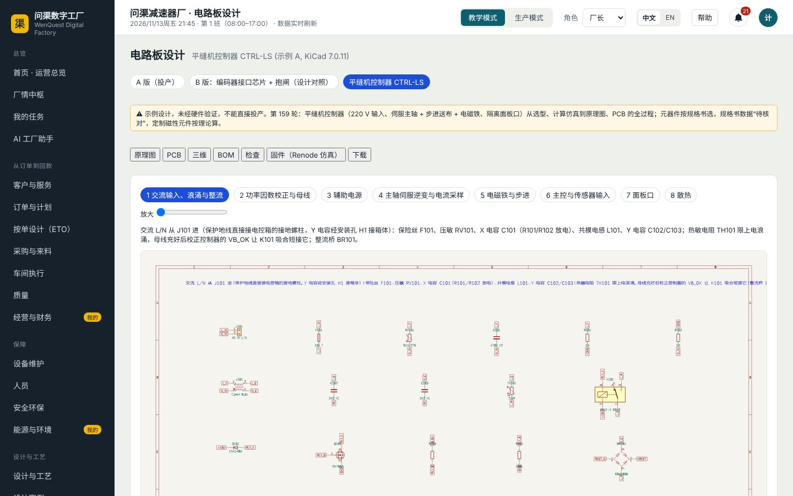
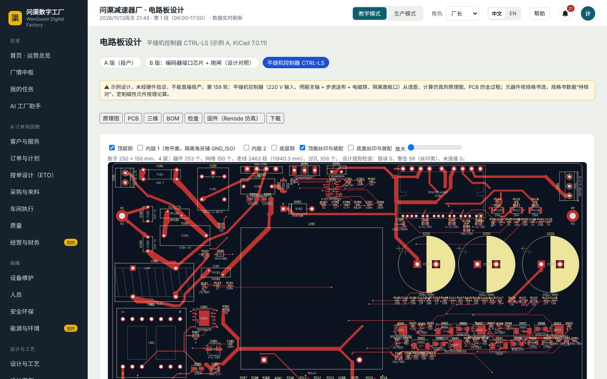
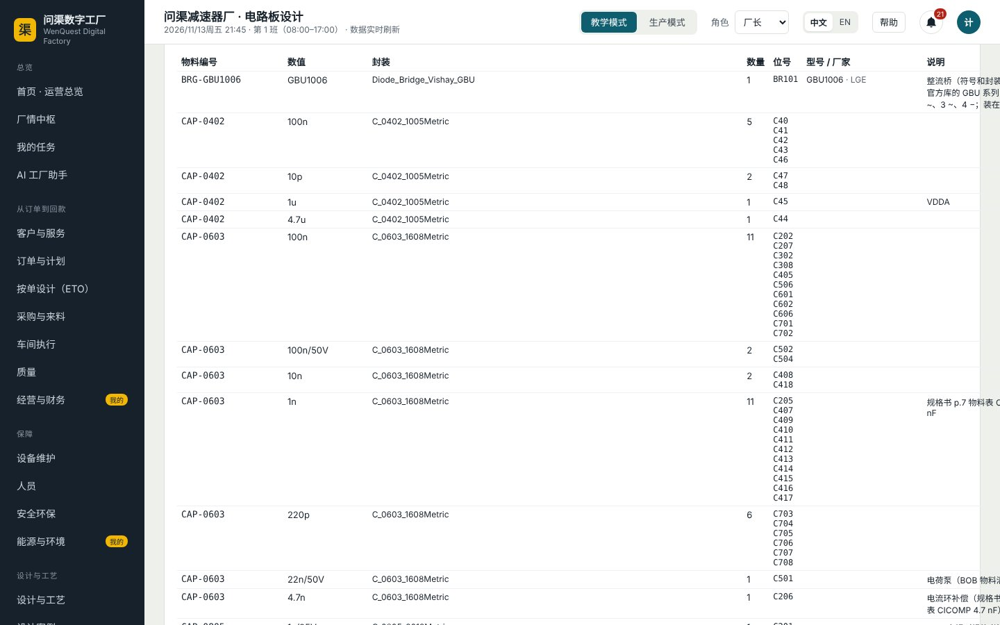
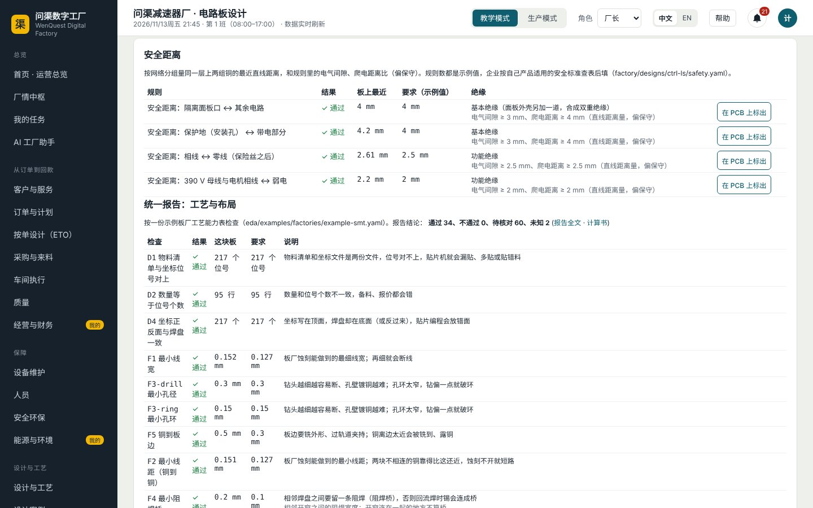
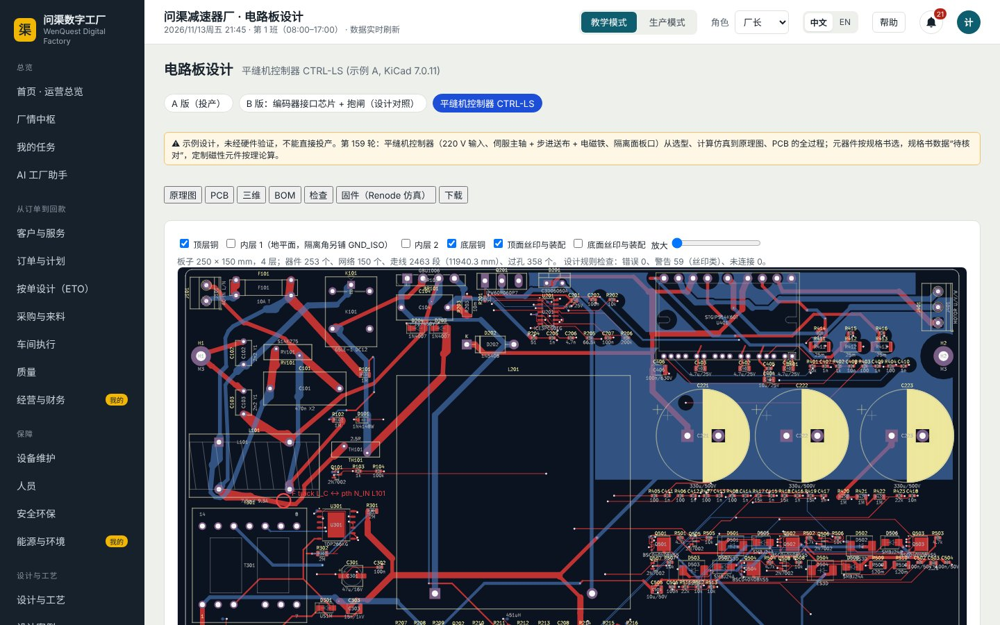
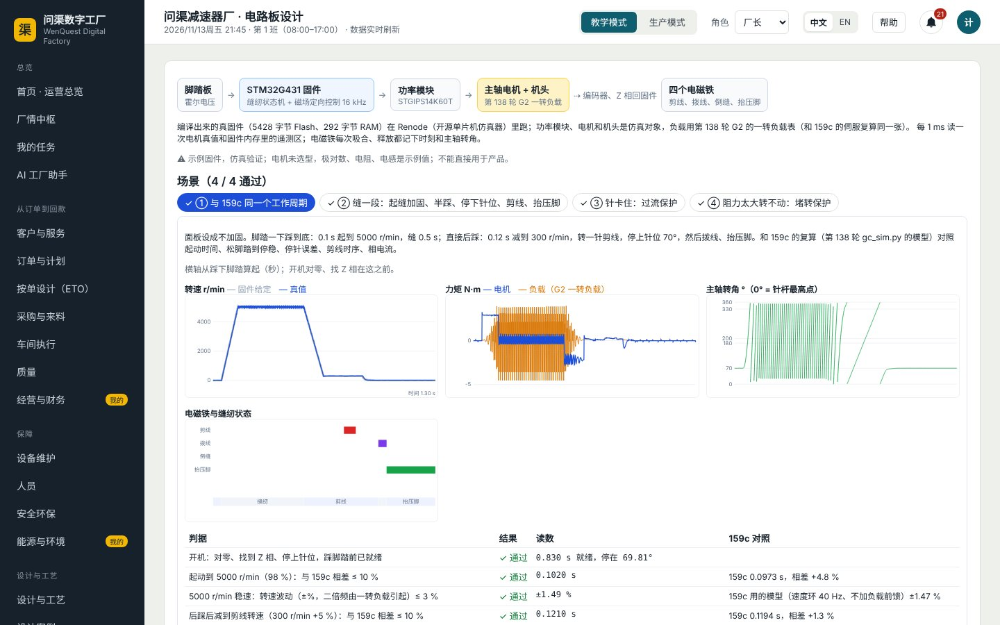
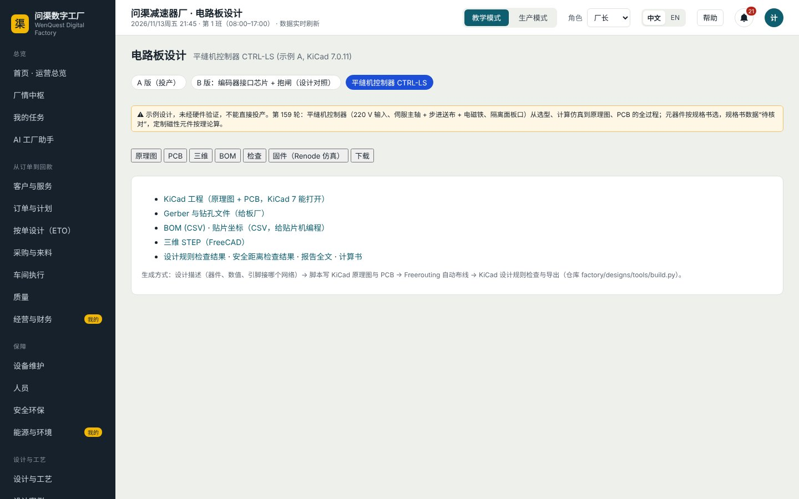

# 平缝机控制器 CTRL-LS：从需求到电路板、制造和固件

CTRL-LS 是第 159 轮按第 138 轮 WQ-LS 平缝机的要求做的电控板：单相 220 V 输入、功率因数校正、主轴伺服（550 W 永磁同步直驱）、
四个电磁铁（剪线、拨线、倒缝、抬压脚）、针距步进电机、隔离的操作面板口，做在一块 250 × 150 mm、四层的板上。

**这是示例设计，没有做过硬件验证，不能直接投产。** 器件是真型号（都在立创或 DigiKey 查过有货），但规格书参数大多还“待核对”；
定制的升压电感、反激变压器按计算书的规格写，没有厂家型号。

## 全过程一张表

| 段 | 做了什么 | 结果在哪看 |
|---|---|---|
| 159a 方案与选型 | 系统框图、器件表（型号、厂家、核实日期与链接、规格书出处） | 数字工厂“电路板设计 → 平缝机控制器 → BOM” |
| 159b 计算书 | 交流输入、整流、校正、母线、逆变、辅助电源、电磁铁、步进、面板口逐块计算 | “检查”页签下的计算书链接 |
| 159c 仿真 | 电路仿真和计算书互相核对（5 项都对上）；主轴伺服复算；电控箱温度 | `docs/设计/WQ-LS/GC/控制器仿真/` |
| 159d 原理图与 PCB | 生成原理图 8 页、布局布线、安全距离与板级热检查 | “原理图”“PCB”“检查”页签 |
| 159e 贴片与制造 | 补底面测试点；问渠电路板厂能接单、贴片、出厂测试 | 电路板厂的“产品与物料清单”“功能测试台”；问渠贴片 |
| 159f 固件 | 真固件在 Renode 仿真器里接 G2 一转负载“缝一段” | “固件（Renode 仿真）”页签 |

## 在数字工厂里看这块板

左边菜单“设计与工艺 → 电路板设计”，上面点“平缝机控制器 CTRL-LS”。

### 原理图

八页：交流输入、浪涌与整流，功率因数校正与母线，辅助电源，主轴伺服逆变与电流采样，电磁铁与步进，主控与传感器输入，面板口，散热。
每页上面有一段说明，讲这一页的电是怎么走的。

### PCB

勾选显示哪几层（顶层、两个内层、底层、丝印）。下面一行是统计：器件、网络、走线、过孔，设计规则检查 0 错误、0 未连接。

### BOM

95 行、217 个元件。比关节驱动板多两列：型号、厂家。最后一列“到外部库查”拼好立创、DigiKey 的搜索地址，点开看现货和价格（只是链接，不参与判定）。

### 检查

三块：

- **安全距离**：高压对高压、高压对低压、隔离两侧……四条规则全部通过（最小 4.00 / 4.20 / 2.61 / 2.20 mm）。间距要求是设计描述里的示例值，
  标着“企业按自己的安规表填”——软件不引用、不编安规条款号和数值，也不声称通过安规认证。
- **统一报告**：线宽、板级热、可制造性等 96 项：通过 34、不通过 0、待核对 60、未知 2。“待核对”是规格书参数还没逐页核对，“未知”是缺数据，都不算通过。
- **板级热**：最热的是钳位电阻 R303，102.8 ℃（板子允许 105 ℃，示例值）。

点一项后面的“在 PCB 上标出”，跳到 PCB 页签，红框标出位置：

### 固件（Renode 仿真）

编译出来的真固件（约 5.4 KB）在 Renode 里跑：功率模块、电机和机头是仿真对象，机头的负载用第 138 轮 G2 算出的一转负载表，和 159c 的伺服复算是同一张表。
四个场景都通过：

1. **与 159c 同一个工作周期**：起动到 5000 r/min 0.102 s（159c 0.097 s）、稳速波动 ±1.49 %（159c ±1.47 %）、减到剪线转速 0.121 s（159c 0.119 s）、
   剪线时 296.8 r/min（159c 295.1）、停针误差 +0.15°。剪线电磁铁在主轴 200°–330° 吸合。
2. **缝一段**：起缝加固（正 4 针、倒 4 针）→ 半踩约 2600 r/min 缝纫 → 回中停下针位 → 后踩剪线 → 停上针位 → 拨线 → 抬压脚。
3. **针卡住**：主轴瞬间卡死，电流冲过 7.5 A，过流保护 1 ms 内关输出。
4. **阻力太大**：电机顶在最大力矩也转不动，200 ms 后报堵转、关输出。

每张图：转速、力矩、主轴转角、电磁铁与缝纫状态；判据表最后一列是“和 159c 对照”。下面能看源码、下载固件包。

录像：`docs/课程视频/首页简介/07-数字工厂/录屏/ctrl-ls-fw.mp4`（中文）、`ctrl-ls-fw.en.mp4`（英文），各 30 秒。

电机还没选型，电机的极对数、电阻、电感是示例值（页面参数表里标着）；它们只影响电流环的细节，不影响和 159c 对照的几项。

### 下载

KiCad 工程、光绘与钻孔、BOM、贴片坐标、三维 STEP、设计规则检查结果、安全距离检查结果、报告全文、计算书。

## 拿到工厂

- **问渠贴片**：“用平缝机控制器 CTRL-LS 的资料包”，见《问渠电子使用说明》。
- **问渠电路板厂**（数字工厂里的一座厂）：能接 CTRL-LS 的单。贴片板 187 个贴片件走贴片线，成品板加 30 个通孔件走后段（选择焊、在线测试、烧录、三防、老化 4 小时、功能测试、包装）。
  功能测试 8 项：采样电阻、母线 390 V、24 / 15 / 5 / 3.3 V、隔离 5 V、面板口耐压。发热大件贴电控箱的铝外壳散热，散热片和导热垫在缝纫机厂装箱时装，不在电路板厂的物料清单里。
- 缝纫机厂改向电路板厂买电控板，要先把缝纫机厂接入工业园，放在后面的轮次。
