# 按单设计（ETO）

数字工厂工作台左侧“从订单到回款 → **按单设计（ETO）**”（第 139 轮上线）。

客户要的东西没有现成的图纸和物料清单（改速比、加长轴、特殊涂装、整套非标设备……），工厂要**先估算报价，接单后再设计、再做**。
这一页把一张非标订单从询价走到收款：

**估算 → 报价 → 接单 → 设计 → 算料 → 计划 → 车间 → 质量 → 发货 → 验收 → 分期开票 → 毛利**

三条规矩贯穿始终：

- **AI 只起草**：估算行、设计、检验计划可以让 AI 起草；凡是写进 ERPNext 的事，都先出一张“提议”，人点“确认”才写。
- **判定只看事实**：能不能报价、能不能发布、能不能发货、能不能开票，都是平台按记下的事实算，不经过 AI。
- **缺数据就是“未知”**：单价、工时、提前期缺了，金额显示“未知”，不拿 0 或估计值顶上；有未知就不能报价。

下面每一步都写：谁做、要不要人确认、ERPNext 里出什么单。截图来自演示减速器厂（虚构客户“示例·华东自动化”）。

| 步骤 | 谁做 | 要人确认吗 | ERPNext 里出什么 |
| --- | --- | --- | --- |
| 一、估算 | 销售 | 不写 ERPNext，不用 | — |
| 二、报价 | 销售 | 要（提议） | 项目（Project）、物料、报价单（Quotation） |
| 三、接单 | 销售 | 要（提议） | 销售订单（Sales Order，带付款计划） |
| 四、设计与发布 | 工艺员 | 要（提议） | 新物料（Item）、物料清单（BOM） |
| 五、算料 | 计划员 | 要（提议） | 工单（Work Order）、请购单（Material Request） |
| 六、计划 | 计划员 | 只看，不写 | — |
| 七、车间与成本 | 计划员、操作工、工艺员 | 下达车间、登记设计工时要（提议） | 作业卡（Job Card）、工时表（Timesheet） |
| 八、质量 | 质检员 | 检验计划要批准；每次检验要（提议） | 质量检验单（Quality Inspection） |
| 九、发货与验收 | 销售 | 发货要（提议）；验收直接登记 | 发货单（Delivery Note） |
| 十、分期开票与毛利 | 销售 | 每一期要（提议） | 销售发票（Sales Invoice） |

教学模式里，提议由老师（厂长）或另一位同学确认；生产模式里由企业指定的人确认。练习见实验 33《一张非标订单：从询价到收款》。

## 一、估算

点“新询价”，填客户、名称、要求、数量（可以另报几档数量）和交期，建出一张作业，编号如 `JOB-2026-0001`。

点“AI 起草”：AI 读要求（和上传的客户图纸里的文字），参照最像的现有产品起草估算行，**只给结构、用量和工时，不给价格**；
价格取工厂的主数据（物料单价、工位费率）。估算分五类：

| 类 | 怎么算 |
| --- | --- |
| 材料、外购件 | 用量 × 单价 × 件数 |
| 工序 | （调整分钟 + 单件分钟 × 件数）÷ 60 × 工位费率（调整一批一次） |
| 外协 | 单价 × 件数 |
| 设计 | 工时 × 设计费率（一次性） |

**报价 = 小计 ×（1 + 风险预留）×（1 + 加价率）**。风险预留、加价率、设计费率、付款计划在工厂清单的 `eto` 一节配置；演示工厂是示例值（10%、30%、65 美元/小时；订金 30%、发货 60%、验收 10%）。

左栏“报价”同时给每一档数量的成本、单价、合计，以及“报价时能否按期”的粗算（设计工时 + 最长采购提前期 + 加工工时 + 发货预留）。
标着“未知”的行要补齐（调整时间、单价、工时……），一行未知，整张就不能报价。

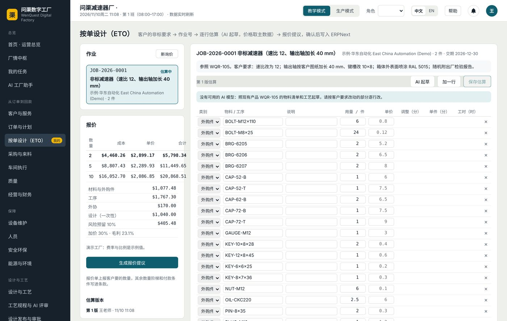

## 二、报价

估算没有未知项后，点“生成报价提议”。提议里列出要写进 ERPNext 的东西：项目、作业的成品物料、报价单（客户要的那档数量报在单上，其余各档和付款条件写进条款）。

确认后，这一版估算**冻结**：再改估算会出新的一版，要重新报价。

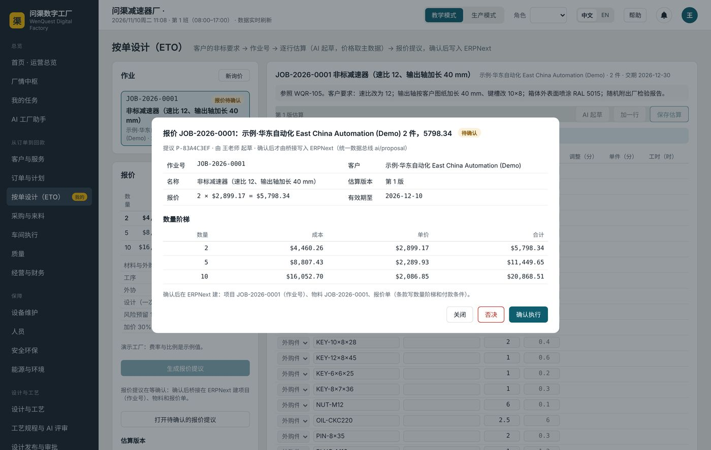

## 三、接单

客户接受后点“客户接受报价”→“生成接单提议”。提议里有销售订单和**付款计划**（按工厂配置的里程碑分期，金额按报价算好，最后一期补齐分位差）。确认后 ERPNext 出销售订单，挂在作业的项目上。

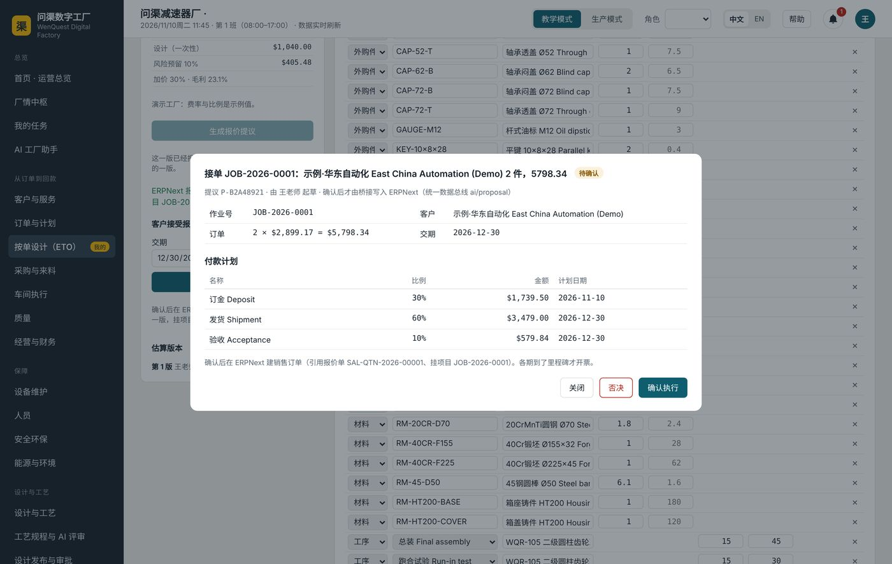

## 四、设计与发布

“设计（物料清单与工艺）”标签：

1. 点“照估算起草”：估算照现有产品起草的，就取那个产品的顶层物料清单和工艺；否则估算里的材料、外购件当子件，工序当工艺。
2. 客户要改的件，选中后点“**复制为新件**”：新编号 = 作业号 + 后缀（如 `JOB-2026-0001-SH`），物料清单和工艺照抄，父件自动改用新件；再改它的工艺和子件。
3. 真正全新的件用“加新物料”（自制件、外购件、原材料），编号也以作业号开头。
4. 本单新件里的自制件和外购件要有**批准的图纸**：每个新件下面写着“图纸：第 N 版（谁批准）”，还没有的点“**去交图纸**”，到“设计发布与审批”上传图纸（PDF 或 SVG），审批人批准（教学模式提交即批准）。原材料不要图纸。
5. 点“发布设计”：平台先检查（编号以作业号开头、类别和单位、子件都存在、自制件有工艺和子件、物料清单没有循环、新件有批准的图纸……），不过就列出原因；过了生成发布提议，确认后 ERPNext 建新物料和物料清单。

发布的设计有**版本和指纹**，各新件的图纸版本也记进去、也算进指纹；作业单上写着按哪张图（图号、第几版、谁批准）做。工单必须用发布的那一版。

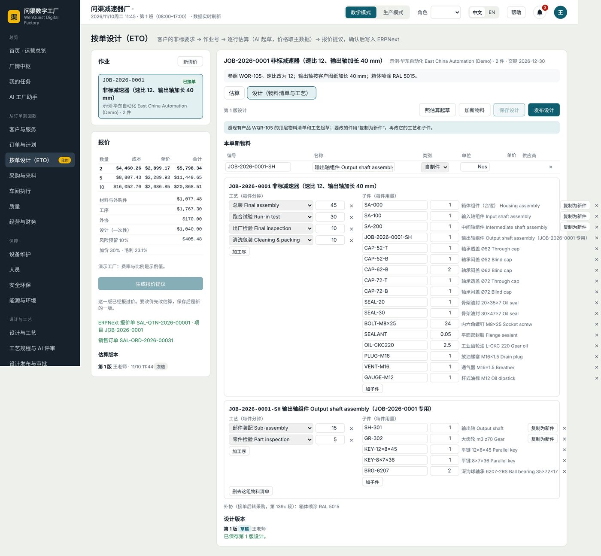

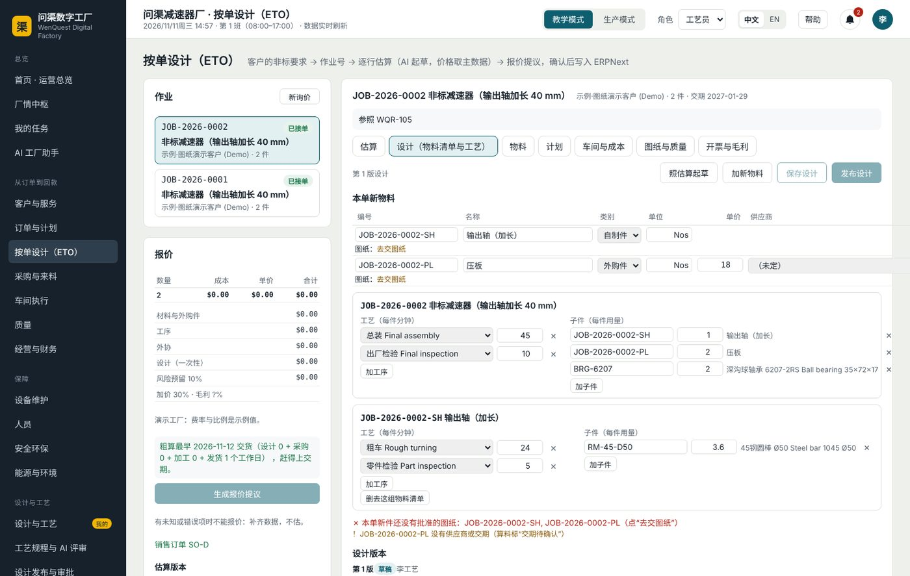

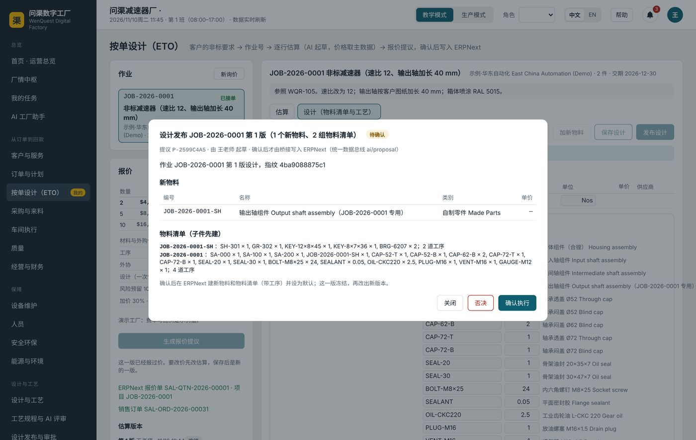

### 设计改版：处理设计变更

发布后再改，会出新版本（旧版原样留底）。新版本发布后，“设计”标签上方出现“**处理设计变更**”表：挂在作业上、还没完的工单、请购单、采购单逐条列出，每条有平台的建议和原因——

| 单据 | 情况 | 建议 |
| --- | --- | --- |
| 工单 | 这个件新版没变 | 照用 |
| 工单 | 改了、还没开工 | 换新版（取消旧工单，再算料按新版下） |
| 工单 | 改了、已开工 | 照用到完工（记让步）；要按新版做就选停止，再算料补 |
| 工单 | 新版不再用这个件 | 没开工取消，已开工停止 |
| 请购单 | 用量减少 | 取消，再算料按新需求补请 |
| 采购单 | 用量减少 | 改量（不少于已到货）；全不要且没到货取消；已到的够了关闭剩下的 |

逐条选好点“提交处理”，确认后在 ERPNext 执行；“照用”只在平台记下。**没处理完，不能再算料、也不能再发布。**
本单专用件已经到货、新版用不上的，按到货数 × 采购单价记**变更损失**；停掉的已开工工单，已花的工序成本也记进去。“车间与成本”标签下方按设计版本分开成本，并写出变更损失合计。

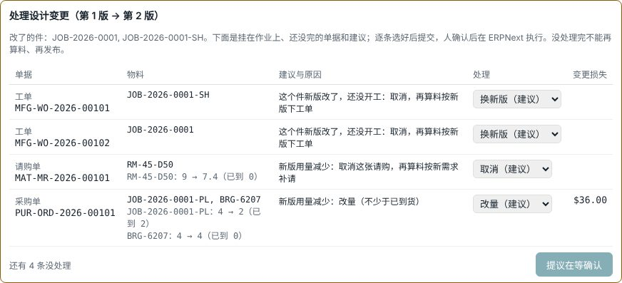

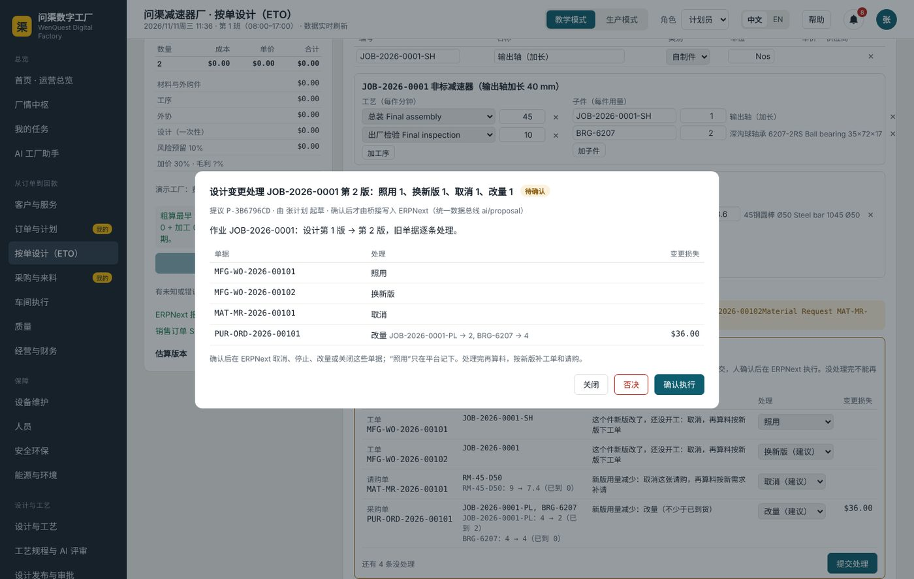

## 五、算料

“物料”标签：按发布的物料清单展开，扣掉库存和在途，列出要做的工单和要买的料。工单和请购单都**挂作业号**（ERPNext 里挂在作业的项目上），别的订单不会挪用。
提前期长的外购件可以先“生成提前采购提议”，不等设计全部定完。点“生成算料提议”，确认后 ERPNext 出工单和请购单。

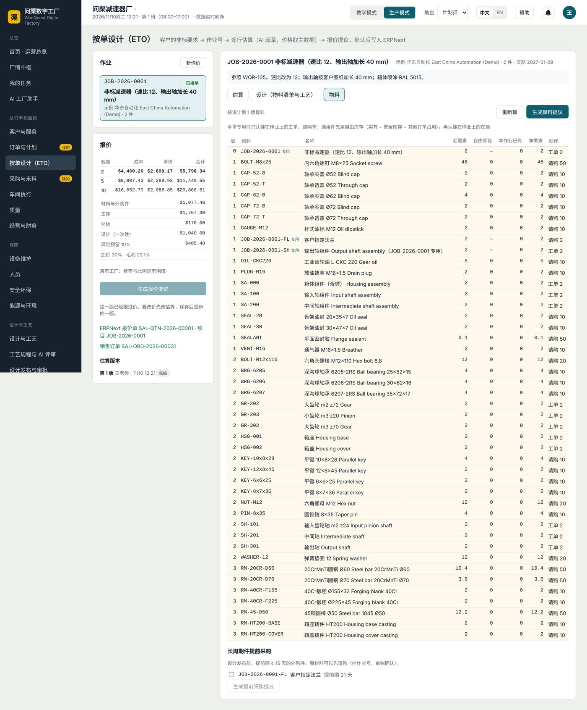

## 六、计划

“计划”标签：从交期倒排——发货预留 1 个工作日，父件开工前一天子件做完或到货，每件工期 = 单件分钟 × 件数 ÷ 480（一天 8 小时）。
页面给出每个自制件最晚哪天开工、每个外购件最晚哪天到货、**最早能交货的日期**、余量（工作日）和关键路径；赶不上的标红。下面是这张作业涉及的工位在各周的负荷。

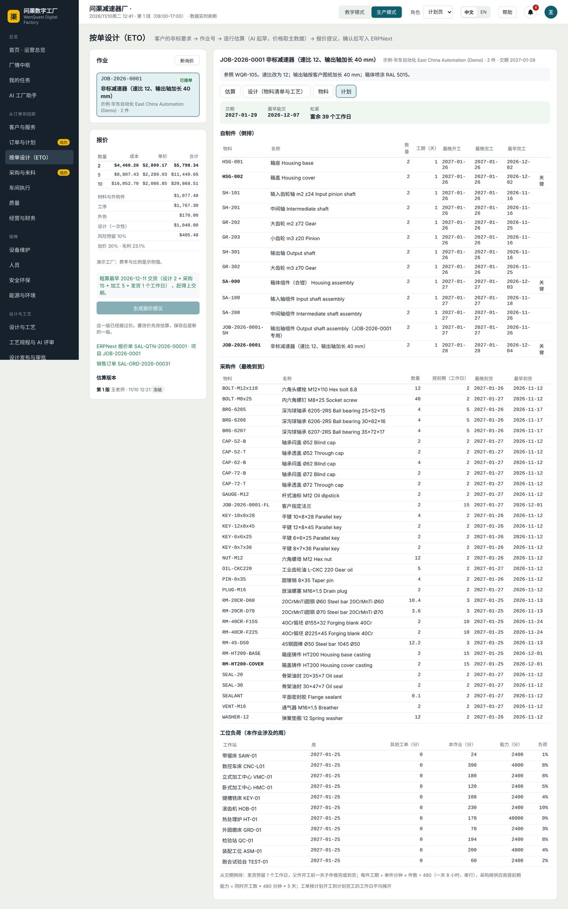

**几张作业抢同一个工位**：负荷里除了在制工单，也算上其他已接单、还没下工单的作业（设计发布了按它的倒排，没发布按估算的工序从交期往回摊）。
某个工位某一周超了，“工位冲突与建议”列出这一周是哪几张作业占着、各占多少分钟、各有多少余量，并建议**余量最大的那张让出这一周**（把它这周的活挪开几个工作日，交期仍赶得上）；
哪张都让不开，就建议加班或外协，并写出缺多少分钟。只是建议，推迟哪张由计划员定，平台不改日期。报价时，“粗算”下面也会写出哪个工位哪周不够。

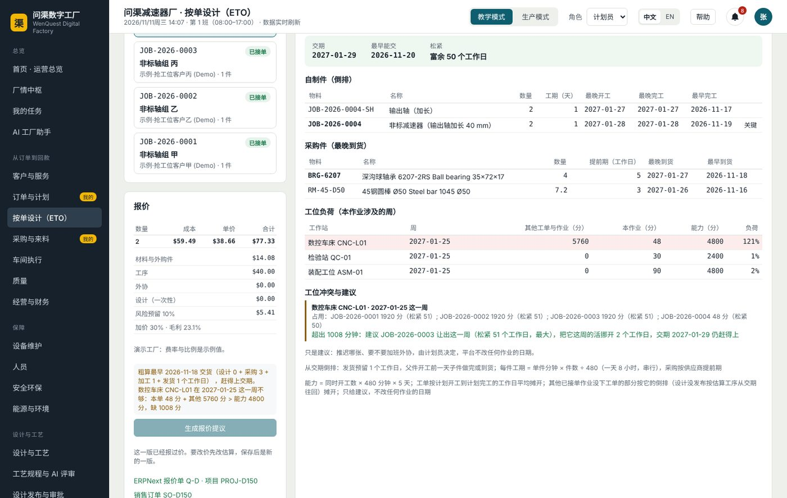

## 七、车间与成本

“车间与成本”标签：

- 工单列表：完工数、状态、用的是不是当前设计版本；点“作业单”打印随工单（工序、要用的料、检验点）。
- 点“**下达车间**”：生成下达提议，确认后派工；操作工在车间终端逐道开工、报工，ERPNext 出作业卡。
- **作业成本：估算对实际**——材料、工序、外协、设计逐项对比。工序按总线上每件的实际节拍 + 调整 + 换刀 × 工位费率；材料按已完工件数 × 标准用量 × 单价；外协按挂在作业项目上、已提交的采购单（数量 × 单价）；设计按登记的工时 × 设计费率。哪一项缺数据，那一项和合计就是“未知”。
- 设计工时：工艺员在这里登记，确认后进 ERPNext 工时表。

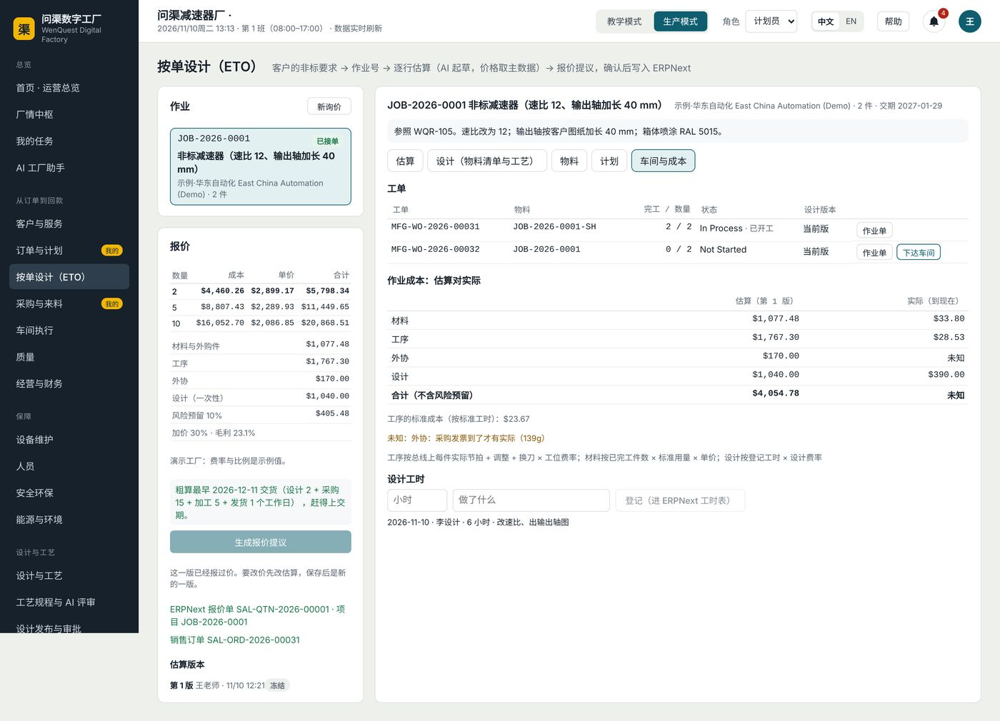

## 八、质量

“图纸与质量”标签：

- **客户图纸**：上传 PDF，文字给 AI 起草估算和检验项时读；扫描件读不到文字，关键尺寸请写进客户要求。
- **检验计划**：“AI 起草”只写图纸或要求里写明的尺寸和公差；质检员核对、保存、**批准**后才能检验。每项写在哪个件上、首件还是终检、名义值和上下限。
- **首件与终检**：选工单和件号，填实测值，平台按上下限判合格；“保存检验记录”生成提议，确认后 ERPNext 出质量检验单。不合格自动开不合格品单。检验记录保存后不能改，记错了只能作废并写原因，再记一条。
- **发货关口**：检验计划没批、作业完工不够、自制子件首件没合格、终检合格件数不够、不合格品单没处置，都会挡住发货，并写出缺什么。

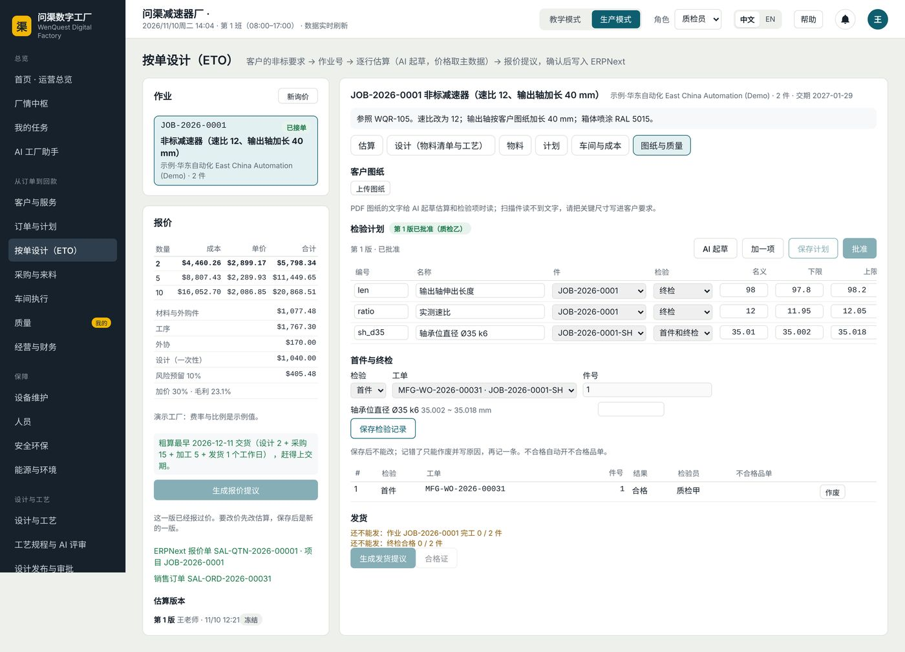

## 九、发货与验收

关口全部通过后点“生成发货提议”，确认后 ERPNext 出发货单；同时可以打印**产品合格证**（每件终检的实测值、设计版本和指纹、检验计划版本）。
客户验收后，在“开票与毛利”里“登记验收”（日期、说明）；没发货不能登记验收。

## 十、分期开票与毛利

“开票与毛利”标签按接单时定下的付款计划，逐期显示：比例、金额、里程碑到了没有、计划日期、状态。

- **里程碑到了才能开那一期**：订金看接单、发货那期看发货单、验收那期看验收登记——按事实，不按日期。
- 每一期只开一次；点“起草发票”生成开票提议，确认后 ERPNext 开销售发票（金额按付款计划）。
- 作业的订单**不走**“工单做完整单自动开票”，避免和分期发票重复。
- 下方“收付与毛利”：订单金额、已开票、已收款、应收未收、还没开票、实际成本（到现在）、毛利。实际成本里有一项未知，毛利就是未知。

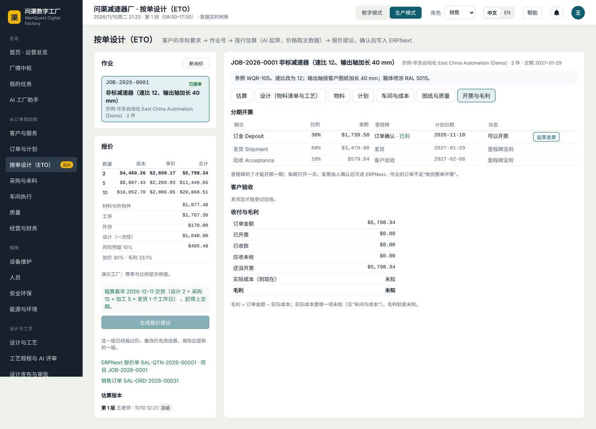

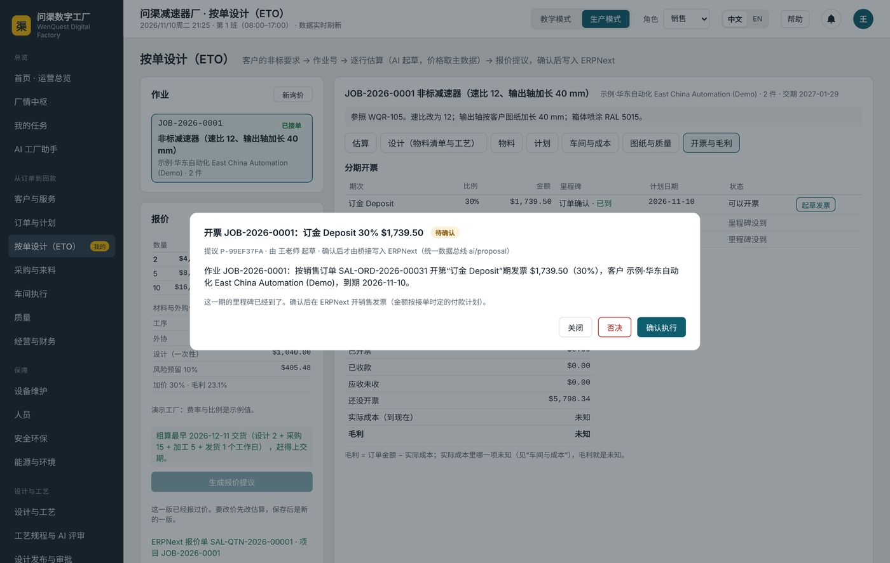

**采购对账**：外协和本单专用件的实际成本按**供应商发票**算；发票还没到的，先按采购单价算并标“发票未到”。下方“采购对账”表逐行列出采购单价、已开票数量、发票单价和差额（发票金额 − 采购单价 × 已开票数量，正数是多付，红色）。
发票的录入、付款在 ERPNext 里做，这里只读。

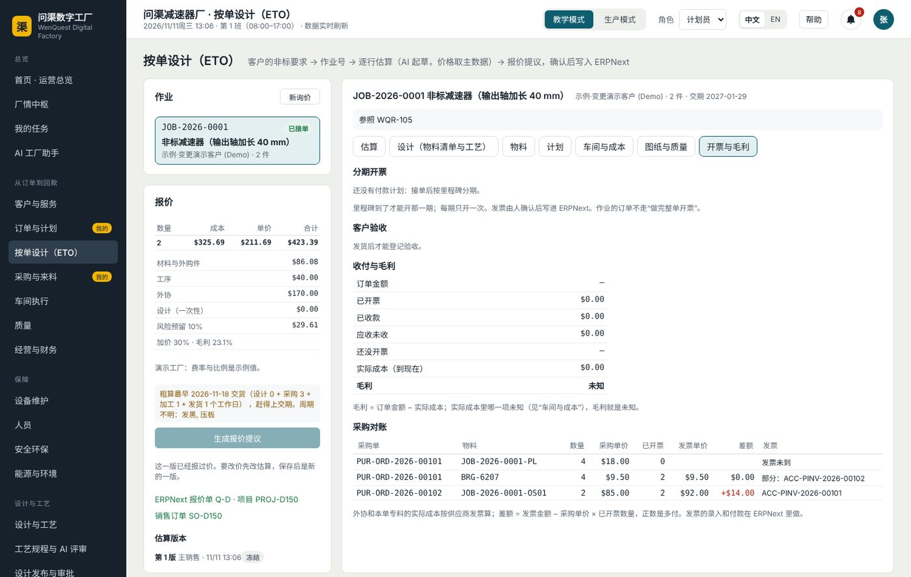

## 常见问题

**为什么有一行“未知”就不能报价？**
报价要对客户负责。缺一个单价或工时，算出来的价格就是猜的；平台宁可挡住，让估算员补上真实的数（问供应商、查工时），也不替你估。

**报价发出去以后客户要改需求怎么办？**
改估算会出新的一版（旧版冻结留底），重新生成报价提议。接单以后要改设计，就在设计里改、重新发布（出新版本），然后在“处理设计变更”表里把旧单据逐条处理完，再重新算料。

**为什么要“复制为新件”，不直接改原来的件？**
原来的件还在别的产品里用。复制出一个以作业号开头的新件，只这张订单用，标准产品的物料清单不受影响，以后查这张订单的设计也清楚。

**为什么作业的订单不走整单开票？**
非标订单周期长、金额大，通常按订金、发货、验收分期收款。整单开票要等全部做完，工厂垫资时间长；分期开票让钱随里程碑到账。两种开票同时走会重复开票，所以作业订单只走分期。

**里程碑到了，为什么还开不了？**
看状态：“开票中”是提议在等确认；“已开票”是这一期开过了；每期只开一次。

**实际成本为什么是“未知”？**
看“车间与成本”下方的未知项：常见的是外协还没下采购单（或采购单没有单价）、某个材料没有单价、设计费率没配置。补齐数据后自动算出来。

**外协发票比采购单贵，成本按哪个算？**
按发票。发票到了，实际成本和毛利就跟着发票走；差额在“采购对账”里列出来，方便和供应商核对。

**我们厂不出图，能关掉“新件要有图纸”吗？**
能：工厂清单 `eto` 一节写 `require_drawing: false`。关掉后缺图纸只提醒、不挡发布。

**估算的价格从哪里来？AI 会不会编价格？**
不会。AI 只给结构、用量和工时；价格取工厂主数据里的物料单价和工位费率。主数据里没有的，那一行就是“未知”，要人补。

**企业版怎么配置？**
在工厂清单的 `eto` 一节写作业号前缀、风险预留、加价率、设计费率、报价有效天数、付款计划（每期的名称、比例、按哪个里程碑：接单、设计发布、发货、验收）、设计发布前新件要不要图纸（`require_drawing`，不写为要）；没配置的项为空，算出来就是“未知”。
