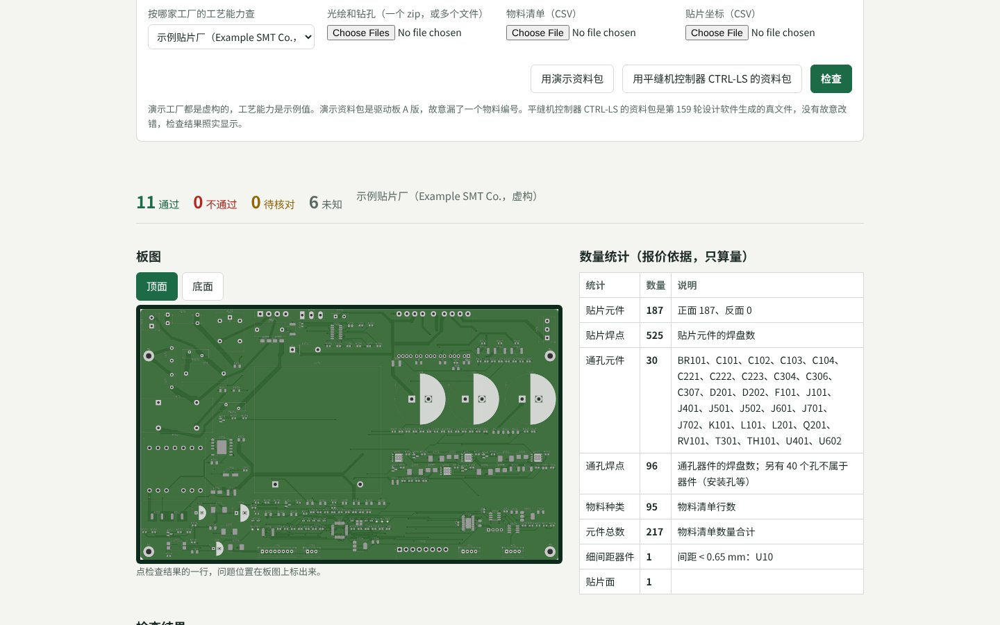

# 问渠电子使用说明（起草台、问渠贴片、网页审图与 KiCad 插件）

问渠电子是问渠的电路板设计与制造平台，网址 `wenquestrobotics.com/eda/`，用问渠账号登录。它有两个页面：设计的人用“起草台”，贴片厂用“问渠贴片”。两边用的是同一套检查程序，判定全由程序做，AI 只起草，由人确认。示例设计和演示工厂都是虚构的，不能直接投产。

## 起草台：把一句话需求变成一块电路板

1. 在需求框里写清楚电压、电流、电机、接口，例如“给 400 W、48 V 的机器人关节伺服电机做一块驱动板，额定相电流 8.5 A，峰值 30 A，带 2500 线增量编码器和 CAN”。需求框下面有三个示例可以点。
2. 点“AI 起草”。半分钟左右出来规格和功能块参数，每个数都标了来源：需求原文、规则推出、AI 假设（铜色高亮，要你回答的问题写在下面）、人填、模板默认。
3. 母线电压、额定和峰值相电流这几项必须有。需求里没写，AI 不许猜，会留空并提问，你填上再点“按改过的数重算”。
4. 看结论：通过、不通过、待核对（器件数据还没人对照规格书核对，不算通过）、未知（缺数据）。展开“计算书”能看到每一步怎么算的。
5. “板子检查”用驱动板模板已经布好线的板子，按你的规格再查一遍工艺、布局和发热。不重新布线，所以电流改大了，大电流线宽会显示不通过。
6. 勾选“我已看过标成‘AI 假设’的数”，下载设计描述（YAML 文件）。草稿不存服务器。

本版只做三相电机驱动板（九种功能单元，拓扑固定）。

## 问渠贴片：客户的资料包进厂前先查一遍

网址 `wenquestrobotics.com/eda/factory/`，起草台页头也有链接。

1. 选按哪家工厂的工艺能力查。现在只有两家虚构的演示工厂：“示例贴片厂”和“示例贴片厂·经济线”，后者设备旧一些，只接常规件。
2. 上传资料包：光绘和钻孔（一个 zip 或多个文件），物料清单和贴片坐标（CSV）。Excel 的物料清单请先另存为 CSV。没有资料包，可以点“用演示资料包”：那是驱动板 A 版的资料包，故意漏了一个物料编号。
   也可以点“用平缝机控制器 CTRL-LS 的资料包”（第 159 轮）：设计软件生成的真文件，没有故意改错。按示例贴片厂查：通过 11、不通过 0、未知 6——器件外框、到板边、ICT 覆盖率、大电流线宽要设计文件才能查（设计端的报告里查过），极性元件 25 个请对照装配图，板子尺寸是示例厂没填能贴的最大最小板子。换“经济线”查有三项不通过：板子 250 × 150 mm 太大（经济线最大 90 × 60 mm）、主控引脚间距 0.5 mm、最小焊盘 0.3 mm——这条线做不了这块板，照实显示。见《平缝机控制器 CTRL-LS》。

   

3. 点“检查”，十几秒出结果：
   - 资料对不对：位号、数量、正反面；
   - 板子做不做得出：线宽、线距、孔、孔环、阻焊桥、铜到板边；
   - 好不好贴：板子尺寸、最小引脚间距、最小焊盘、极性方向（光绘里没有第 1 脚的信息，有极性的元件列出来请人确认）。
   资料包里没有网表和器件外框，有几项查不了，判“未知”，不判通过。点一行结果，板图上会标出位置。
4. 数量统计是报价和备料的依据：贴片元件数（正反面）、焊点数、通孔件数、物料种类、元件总数、细间距器件数。软件只算量，不算钱。
5. 列名或层认错了，在“列映射与层”里改，再点“检查”。
6. 点“AI 起草问题单”。AI 只拿到没通过的检查结果，拿不到你的文件。每条问题都必须引用一条检查结果，编出来的会被程序退回。你逐条改、删、加，勾选确认后下载：YAML 给设计端用，Markdown 发给客户。

上传的文件只在这一次检查里用，算完就删，不存服务器，也不用来训练。

## 问题单回到设计端

设计的人收到问题单（YAML 文件），在问渠电子的工具里运行“问题单对到设计”，它会指出每条问题对应设计描述里的哪个器件、哪一层，例如“C47 没有物料编号，所以没进物料清单”。改完设计、重新导出资料包，再查一遍，问题单上的项会显示“已解决”。

## 网页审图：不装软件看原理图和板子

起草台页头点“网页审图”。选一块示例板子，就能在浏览器里看它的原理图和板子：滚轮缩放，拖动平移。右边列出这块板子报告里没通过的项，点一条，板子上跳到那个器件。

也可以点“打开自己的 KiCad 文件”，选电脑上的原理图、板子文件。文件只在你的浏览器里打开，不上传到服务器，所以这里不做检查。要检查，用问渠贴片上传资料包，或者在 KiCad 插件里跑。

看图用的是开源的 KiCanvas。

## KiCad 插件：在 KiCad 里一键检查

插件给 KiCad 9 及以后的版本用。它检查编辑器里打开着的板子，判定和网页、问渠贴片是同一套程序，不用 AI，也不联网。

安装：

1. 在帮助页下载插件压缩包（wenquest-eda-kicad-plugin.zip）。
2. 解压，把里面的 wenquest-eda 文件夹放进 KiCad 的插件文件夹。Windows：文档\KiCad\9.0\plugins；macOS：~/Documents/KiCad/9.0/plugins；Linux：~/.local/share/kicad/9.0/plugins。
3. 在 KiCad 里打开“首选项 → 插件”，勾选“启用 KiCad API”，然后重启 KiCad。第一次启动会自动安装插件要用的几个 Python 库，要等一会儿。装好后，板子编辑器的工具栏上会多一个绿色的圆形按钮。

使用：按下按钮，浏览器里会打开一个只在你自己电脑上的结果页。

- 每条结果旁边有“定位”，点了 KiCad 里就选中那个器件并放大。
- “把摆放读回设计描述”：在 design.yaml 旁边另写一份 design.readback.yaml，原文件不动，你核对后自己替换。
- “出报告”：报告写在工程文件夹的 wqeda-report 里。

按哪家工厂的工艺能力查：工程文件夹里放一份 wqeda-factory.yaml 就按它查；没有就用插件自带的示例工厂（虚构，数值是示例）。

KiCad 9 的插件还不能在编辑器侧边放面板，所以结果在浏览器里看。KiCad 7、8 的用户可以用命令行做同样的检查。

## 录像

帮助页上有三段半分钟左右的录像：起草台、问渠贴片、网页审图。录像里 AI 的回答是事先准备的示例，设计和工厂都是演示数据。

## 次数与记录

AI 起草（起草台和问题单）要登录问渠账号，每人每天有次数上限。每次调用模型都有记录：谁、什么时候、用的哪个模型、是否通过程序校验。问题单的记录只记工厂名和结果条数，不记内容。美国站用 Claude，国内站用已备案的 DeepSeek。
