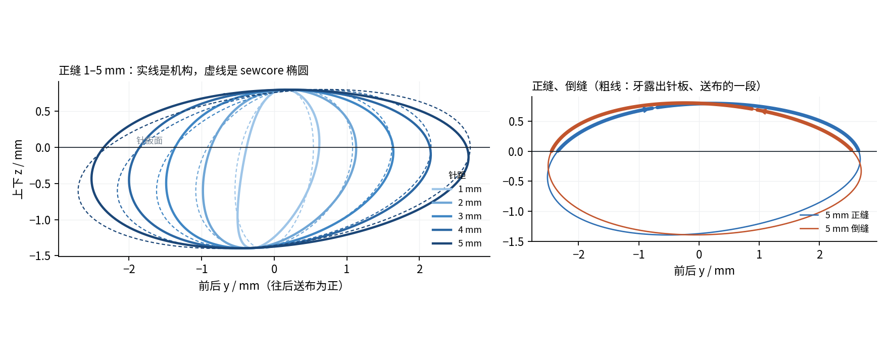

# WQ-LS 送布组：送布、抬牙、针距调节与倒缝、油泵（G4.6，2026-11-11）

**一句话**：上轴的送布偏心经一根竖直连杆、送布调节器、水平连杆带动送布摆轴，推牙架前后走；下轴的抬牙偏心经抬牙连杆、抬牙摆轴的叉子把牙架前端抬起放下。两条运动合成送布牙的椭圆轨迹。针距和倒缝只改调节器的角度。

**程序**
- 平面连杆工具：`factory/digital/cae/linkage.py`（测试 `tests/test_linkage.py`）。
- 尺寸综合、轨迹校核：`tools/wqls/g4_feed.py` → `送布机构.json`；轨迹图 `g4_feed_fig.py` → `送布组_轨迹.png`。
- 零件：`tools/wqls/cad/feed.py`（由 `cad/mech.py` 调用）；一转运动 `g4_mech.py`；干涉检查 `cad/mech_check.py`。
- 动力学和强度：`tools/wqls/g4_feed_dyn.py` → `送布动力.json`（`dyn.py` 读它，G2 上轴和电机复算用）。
- 油泵：`tools/wqls/g4_oil.py` → `油泵.json`。
- 机座里的支承：`cad/housing.py` 的 `feed_seats()`；毛坯铸孔 `cad/blank.py`。

## 一、布置

坐标同整机：x 沿上轴（机头在左），y 前后（往后为正，送布方向），z 上下（机座顶面 z 0）。所有运动件都在垂直于 x 的平面里动，x 是“层”。

| 件 | 位置 | 材料、质量 |
|---|---|---|
| 送布偏心 | 上轴 x 327…335（立柱里），偏心 3.0，外径 Ø26（最薄处壁厚 2） | 45 钢，21 g |
| 送布连杆 | 竖直，长 250，大头套偏心 Ø26，小头 Ø6 销 | ADC12 压铸铝，50 g（钢的要 141 g，惯性力太大） |
| 送布调节器 | 机座里上轴正下方（y 0，z −50），x 311…319；滑槽里一个滑块，调节器轴 Ø8 装在立柱下左横筋的座里 | 45 钢 |
| 水平连杆 L2 | 滑块销 P → 送布摆轴曲柄 C，x 320…326，从下轴、下带轮下面过去 | 45 钢，28 g |
| 送布摆轴 | y 76，z −40，Ø10，x 22…320；曲柄 rc 10 朝下（x 313…319），前端摆杆 ra 27 朝上（x 28…32） | 45 钢，196 g（含曲柄、摆杆） |
| 牙架、送布牙 | 牙架沿 y，x 23.6…27.5，后端铰在摆杆上（T），前端滑块销在抬牙叉槽里（K）；送布牙框式，三排牙对着针（以一转里的平均位置对中），两根侧梁绕开旋梭；送布牙单独一件，用螺钉装在牙架上（三维模型里和牙架画成一体） | 牙架 45 钢；送布牙 20CrMnTi 渗碳淬火 58–62 HRC；合计 29 g |
| 抬牙偏心 | 下轴 x 108…116，偏心 1.19 | 45 钢 |
| 抬牙连杆 | 抬牙偏心 → 抬牙曲柄 D | ADC12，16 g |
| 抬牙摆轴 | y −45，z −28，Ø10，x 15…122；曲柄 rd 12，叉子 x 19…23 | 45 钢，76 g |
| 油泵 | 下轴 x 290…296 的泵偏心（0.4，外径 Ø16），柱塞 Ø3（头部 Ø8）；泵体 x 289…300，用两个 M4 固定在立柱下左横筋上 | 见第七节 |

**和细则不一样的地方**（施工中为让开已有零件改的，细则 G4.6 施工记录偏差 1 有理由）：调节器不在立柱里，在立柱脚下的机座里；L2 在调节器和送布连杆之间（第一次放在 x 336…342，一转检查碰下带轮的下沿）。

## 二、尺寸综合与轨迹

sewcore 给的送布牙轨迹（不改）：最高时牙顶露出针板 0.8，上下全行程 2.2；前后全行程 = 针距 ÷ 0.926；抬到最高在上轴 34°，往后送到最远在 108.2°。

g4_feed.py 先用最小二乘按 sewcore 椭圆定尺寸，再用 sewcore 的送布判据直接校核机构的实际轨迹并微调（Nelder–Mead），结果：

| 参数 | 数 |
|---|---|
| 送布偏心 eF、相位 | 3.0、−17.8° |
| 抬牙偏心 eL、相位 | 1.19、142.0° |
| 牙离牙架线的高度 | 12.0 |
| 前端抬起点的高度偏置 | 1.0 |

正缝、倒缝 1–5 mm 共 10 档，**sewcore 送布判据全部合格**：

| 项 | 结果 | 要求 |
|---|---|---|
| 针在布里时牙拖布 | 0.000 mm | ≤ 0.05 |
| 牙顶露出针板 | 0.797–0.804 | 0.8 |
| 起牙角（离针出布） | 47.0–50.5° | 20–180° |
| 实际针距与名义 | < 0.01% | ≤ 5% |

机构轨迹与理想椭圆的偏差：前后 ≤ 0.29、上下 ≤ 0.28 mm（只记录，见细则偏差 2：连杆机构的轨迹本来不是正椭圆）。见图 `送布组_轨迹.png`。

## 三、针距调节和倒缝

- 调节器角度每毫米针距 3.52°，5 mm 时 17.7°。零位 0.13°（做进零件）。按直线刻度，针距误差 ≤ 0.021 mm（要求 ≤ 0.2）。
- 倒缝：扳倒缝扳手，调节器绕零位对称地转到另一边。倒缝针距是正缝的 0.997–1.007 倍（要求差 ≤ 5%）。

## 四、一转干涉

（见第十节的结果表；每 2° 一帧，针距 5 mm 正缝、5 mm 倒缝、3 mm 正缝三种状态。）

第一次检查发现、已改的：
1. L2 碰下带轮的下沿 → L2 移到调节器和送布连杆之间（x 320…326），送布摆轴曲柄跟着移到 x 313…319，摆轴缩到 x 320。
2. 牙架离旋梭 0.97 → 牙架从 x 23.6 起。
3. 牙架在最低点碰旋梭轴（轴顶 z −16.5）→ 牙架下面在旋梭轴上方让开 y ±9.5、底面抬高 1.5（牙下面那段牙架连着侧梁，高 10.4，削掉 1.5 后强度见第六节）。
4. 抬牙叉头最高到 z −5.5，碰机座顶板底面（z −5.6）→ 顶板底面在叉子上方铸出 1.3 深的让位槽（顶板这里剩 4.3）。

改完再查一遍，又查出、已改的：
5. 送布偏心外径 Ø22 时最薄处壁厚 0（孔 Ø12、偏心 3 + 孔半径 6 = 9 > 11 − 2 不够）→ 外径 Ø26，最薄处 2；连杆大头跟着改。油泵偏心同样问题，外径改 Ø16。
6. 送布牙机构综合出的牙点一转里平均在针前 1.8 mm，侧梁离针板下开口只剩 0.48 → 牙排、侧梁按平均位置对中针。
7. 抬牙叉离让位槽边 0.26 → 让位槽放大到 x 17…24.5、y −42…−21。
8. 送布连杆过孔、调节器板离调节器座各 0.999（正好卡在 1 mm 线上）→ 过孔放到 x 325.5…339.5，调节器板减薄到 7.8。
9. 油泵柱塞头离下轴 0.6 → 柱塞头往下让开（现 1.6）。
10. 送布牙侧梁的右端（x 27.5）伸到顶板底面以上，离针板下开口右端面 0.5 → 开口右端由 x 28 放到 29.5（针板座 x ±32，针板仍有 2.5 宽的搭边）。

## 五、动力学（5000 r/min）

能量法：各件质心、转角由一转运动给出，T = Σ(m a·v + I ε θ̇)/ω；送布阻力（牙在针板上面时）：压脚 50 N 下布的摩擦 μ 0.25 阻碍送布、牙往上顶压脚。

| 档 | 上轴（送布链）力矩最大 | 下轴（抬牙链）力矩最大 | 平均功率 | 送布连杆力最大 |
|---|---|---|---|---|
| 5 mm 正缝 | 0.158 N·m | 0.053 N·m | 5.3 W | 85 N |
| 5 mm 倒缝 | 0.134 | 0.053 | 5.1 | 81 |
| 3 mm 正缝 | 0.098 | 0.052 | 3.1 | 71 |

**对上轴和电机的影响**（G2 程序复算，`G2/结果.json`；送布偏心从 x 139 移到 x 331，送布力换成上面的实际值）：

| 项 | G4.5 | G4.6 | 判据 |
|---|---|---|---|
| 前轴承 6202 寿命 | 27 800 h | 27 200 h | ≥ 20 000 h |
| 后轴承 6201 寿命 | 557 000 h | 431 000 h | 同上 |
| 曲柄处挠度 | 96.8 µm | 97.6 µm | D 版已接受 103 µm |
| 一阶临界转速 | 11 410 r/min | 11 600 r/min | ≥ 1.5 × 5000 |
| 疲劳安全系数 截面 I–IV | 3.62 / 4.51 / 6.80 / 4.22 | 3.62 / 4.52 / 6.86 / 4.27 | ≥ 1.5 |
| 驱动力矩 均方根 / 峰值 | 2.77 / 4.86 N·m | 2.73 / 4.82 N·m | 电机按 G2 做法 (b)，不变 |
| 平均功率 | 64.3 W | 66.5 W | — |

送布偏心离后轴承近了，前轴承受力几乎不变；送布组的惯性力矩比原来按集中质量估的小，驱动力矩均方根还略降。电机选型不变。

**旋梭组复算**（`g4_hook.py`，`旋梭组计算.json`）：左铜套右移到 x 32…46，下轴加上抬牙连杆力 47 N，全部合格（轴套 pv 2.32，许用内；下轴疲劳安全系数 23.4；齿轮、带余量不变）。

## 六、强度（5000 r/min、5 mm 针距；正缝、倒缝取大的）

材料：送布连杆、抬牙连杆 ADC12（σ0.2 150 MPa，疲劳极限取 60）；其余 45 钢调质（σs 355，σ−1 270，τ−1 155）；缺口系数 Kf 取 2。牙架、摆轴的力按牛顿—欧拉逐帧解（牙架受摆杆、抬牙叉、布的力和惯性力）。

| 件 | 最大载荷 | 应力 | 安全系数 |
|---|---|---|---|
| 送布连杆（8 × 8，长 250） | 85 N | 1.3 MPa | 压杆稳定 45；疲劳 23 |
| 送布连杆大头（Ø26 × 8 套在偏心上，油润滑） | — | pv 2.8 MPa·m/s | 小汽油机铝连杆直接跑在曲柄销上是同一做法 |
| L2（6 × 8） | 98 N | 2.0 MPa | 压杆稳定 > 400 |
| 送布摆轴 Ø10（扭；倒缝时最大） | 1.12 N·m | τ 5.7 MPa | 静 36；疲劳 17 |
| 抬牙摆轴 Ø10 | 0.56 N·m | τ 2.8 MPa | 疲劳 52 |
| 牙架（3.9 × 5 段） | 909 N·mm | 56 MPa | 疲劳 2.4（要求 ≥ 2） |
| 送布牙两根侧梁（3 × 2.5，悬臂） | 压脚 50 N 全压在牙上，每根 501 N·mm | 160 MPa | 静 6.7；疲劳 2.45（20CrMnTi 渗碳淬火；用 45 钢只有 1.4，不够） |
| 牙架（牙下面、连侧梁的段，高 10.4） | — | 16 MPa | — |
| 销 P、C、T、K | — | τ ≤ 4.1 MPa | 很大 |
| 含油轴套（送布、抬牙摆轴） | — | pv 0.22 / 0.12 MPa·m/s | 许用 1.8 |

**送布摆轴的扭转**：曲柄到前端摆杆 286 mm，最大力矩下扭 0.0041 rad，牙前后差约 0.11 mm（5 mm 针距的 2%）。这是动态的弹性变形，大部分是惯性力，和运动同相，只让针距略短，在 5% 的要求内。要更小可以把摆轴改 Ø12（扭转变形约减半）。

## 七、油泵与润滑

| 项 | 数 |
|---|---|
| 柱塞 Ø3，行程 0.8 | 每转 5.65 mm³，容积效率 0.7 |
| 流量（5000 r/min） | 19.8 mL/min |
| 柱塞弹簧预紧 | 0.62 N（吸油行程惯性力加 20 kPa 真空，取 3 倍） |
| 泵出口压力（暖机，VG 10 白油） | 14 kPa |
| 泵出口压力（冷机 20 °C，按 VG 22） | 73 kPa（单向阀、密封按 0.1 MPa 设计） |
| 流动 | 各段都是层流（Re < 2000） |

油路：泵 → 机座里、立柱里 Ø4 × 1 铜管 → 机臂顶的分油块（溢流孔回油盘）→ 上轴前、后轴承，针杆、挑线油毡。旋梭一路从泵出口分出，经针阀（调节螺钉在机座底下）到旋梭轴中心的 Ø2.5 油孔，全开约 1.8 mL/h。齿轮、下轴轴承、送布和抬牙摆轴靠溅油和含油轴套。

## 八、机壳的改动（下件机座）

- 送布摆轴两个座（前 x 34…46，后在立柱下左横筋上 x 297…310），孔 Ø14 H7；前座一道 4 mm 的筋接机座顶板（6 mm 时凝固仿真有 3.5 cm³ 的孤立液相区）。
- 抬牙摆轴两个座：前 x 25…37（Ø24 凸台，孔 Ø16 H7）、后 x 96…106（孔 Ø14 H7）。前孔大一档，加工后孔的镗刀才能从前孔里穿过去。
- 调节器轴座 x 297…310，孔 Ø10 H7。
- 送布连杆过孔（机座顶板 x 325.5…339.5、y −10…12）；抬牙叉上方的让位槽（x 17…24.5、y −42…−21，深 1.3）；针板下开口右端放到 x 29.5。
- 镗杆工艺孔：左端壁 Ø16、Ø18，右端壁和右横筋 Ø16、Ø14；加工后压碗形堵盖。
- 这些孔都用砂芯铸出（抬牙前孔 Ø15，调节器孔 Ø6，其余比成品小 3），否则凸台是实心热节。

## 九、加工（合件工序 70 加的孔）

| 孔 | 怎么加工 | 精度预算（占公差） |
|---|---|---|
| 送布摆轴两孔 Ø14 H7，同轴度 Ø0.04 | 后孔 B 180° 从右端壁、右横筋的工艺孔进；前孔 B 0° 从左端壁工艺孔进 | 0.023（58%） |
| 抬牙摆轴两孔 Ø16 / Ø14 H7，同轴度 Ø0.03 | B 0° 从左端壁工艺孔进：先镗后孔（刀从前孔铸出的 Ø15 里穿过），再镗前孔 | 0.018（60%） |
| 调节器孔 Ø10 H7 | B 180° 加长钻、铰，从 Ø14 工艺孔进 | — |

工艺规程、数控程序、三坐标检测计划（P22–P27）、合件图纸、刀具通过检查都已加上。

## 十、验收结果

（收尾时填。）
