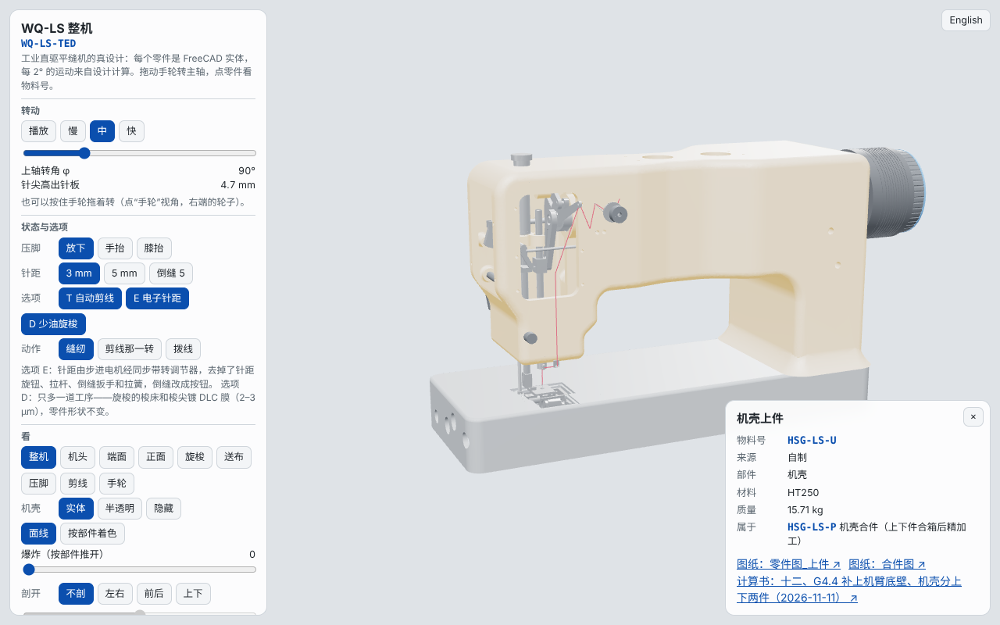
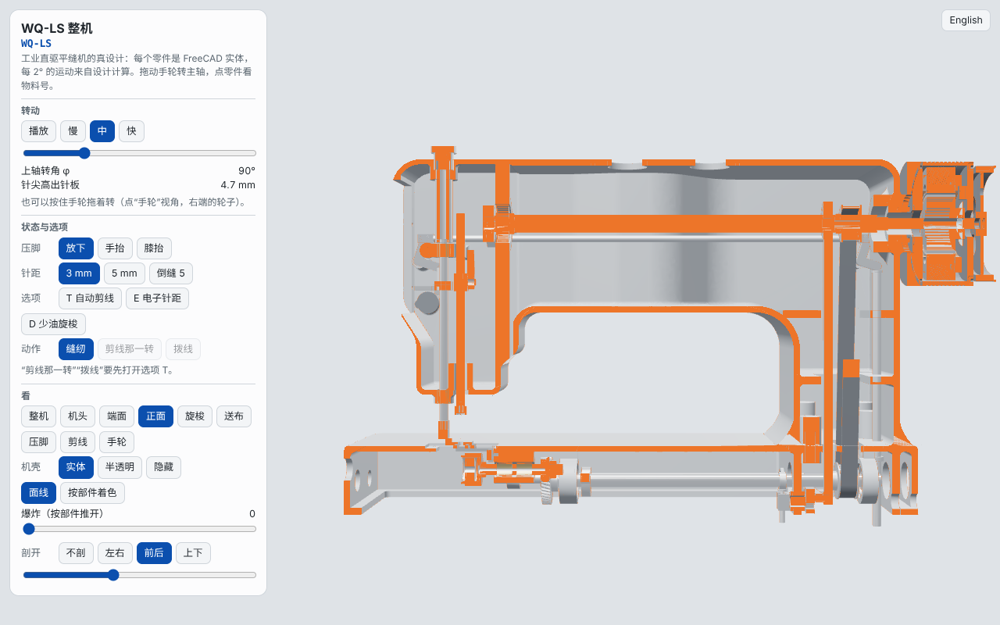
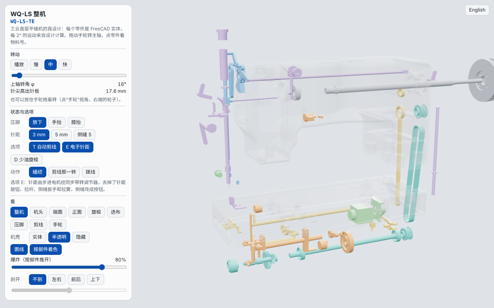
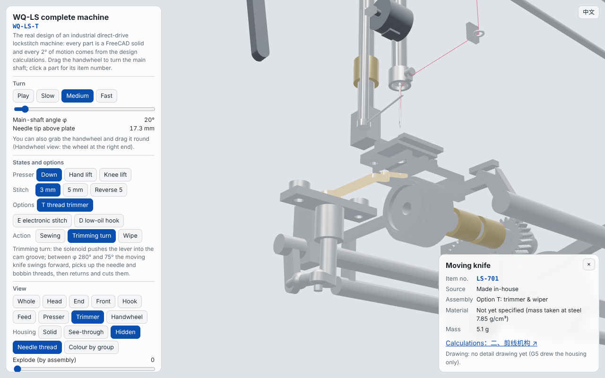

# G6.1 网页三维整机“WQ-LS 整机”（第 138 轮，2026-11-13）

## 结论

一个网页，打开就是整台 WQ-LS：98 个零件（FreeCAD 实体）、每 2° 一帧的运动（设计计算 `g4_mech.py`），8 种变型（T、E、D 任意组合）、压脚三种状态、针距三档、剪线那一转和拨线。
拖手轮转主轴，一键爆炸、三向剖开，点零件看物料号、来源、材料、质量、图纸和计算书那一节。中英文。

- 数字工厂：`/wqls/index.html`（公开页面，不用登录）；“设计与工艺 → 本厂物料”里问渠缝纫机厂的物料有“在三维整机里看 ↗”；设计案例“WQ-LS”第 5 步有链接。
- 教材：《缝纫机设计与制造》第 27 章 27.3 节“三维模型 27-2”，互动资源页也列了。

## 一、数据怎么来的

| 步骤 | 程序 | 结果 |
|---|---|---|
| 1. 各状态的整机 | `cad/mech.py`，`WQ_FEED` × `WQ_PRESS` × `WQ_OPT`（none、TE 各 9 组，T、E 各 1 组），共 20 个整机目录 | 每个零件的 STEP、质量 |
| 2. 网页网格 | `render/web_tess.py`（FreeCAD 重新划网格，线偏差 0.1 mm、角偏差 0.5） | 比出图用的粗，网页加载快 |
| 3. 打包 | `g6_web.py`：网格和运动按内容去重；27 组运动（档位 × 压脚 × 剪线）由 `g4_mech.py` 重算 | `machine.json`、`mesh.bin`、`frames.bin`、`doc/`、`dwg/`、`codes.json` |
| 4. 物料号 | `tools/wqls/part_codes.yaml`（三维零件名 → 物料号，G7.1 的 BOM 也用它） | 98 个零件全有号 |

只带 T 或只带 E 的变型没有在每个状态下单独建，由不带选项的零件加上 TE 里的选配件拼成；在 s3、放下时与真建的逐个比对，网格完全一样（程序里有断言）。

数据量：98 个零件、141 份网格、18.2 万个三角形；网格 1.99 MB、运动 0.54 MB、零件表 0.13 MB，压缩后合计约 1.25 MB（计划上限 15 MB）。

## 二、物料号

| 范围 | 规则 |
|---|---|
| LS-1xx 主轴与传动、LS-2xx 刺布挑线、LS-3xx 旋梭、LS-4xx 送布与油泵、LS-5xx 压脚与操纵件、LS-7xx 选配件 T、LS-8xx 选配件 E | 我们自己设计的件；kind = make 本厂做，buy = 按我们的图外购（弹簧、铜套） |
| BUY-… | 照型号买的：机针、梭壳、同步带、轴承、电磁铁、步进电机、按钮；直驱电机的 9 个零件都用电机的号 BUY-MOTOR-LS，并写明是电机里的哪一件 |
| HSG-LS-U、HSG-LS-L，合件 HSG-LS-P | 机壳，沿用 G5 |
| 沿用缝纫机厂已有的 | LS-101 上轴、LS-102 下轴、LS-201 针杆、LS-301 旋梭、LS-401 送布偏心、BUY-MOTOR-LS、BUY-NEEDLE-DB、BUY-BOBCASE、BUY-BELT-LS |

改正：`G4/旋梭组.md` 把下轴写成 LS-501，与工厂的 LS-102 冲突，已改成 LS-102（LS-501 现在是压脚杆）。
缝纫机厂里现在的 HSG-LS、LS-401 × 2 等是示意 BOM，G7.1 按这张表换成真的。

材料只写设计文档里写了的（45 钢调质、20CrMnTi、ADC12、HT250、锡青铜、琴钢丝）；没写的页面显示“未定（质量按钢 7.85 g/cm³ 算）”，不编。
图纸：现在只有机壳有零件图（G5），其他零件点开显示“这一件还没有出零件图”。

## 三、页面

| 功能 | 做法 |
|---|---|
| 转动 | 播放 / 慢、中、快；滑块；按住手轮拖（“手轮”视角，手轮在右端，从左前方看被电机挡住）。帧间插值：平移线性、转动球面插值，拖动是连续的 |
| 状态与选项 | 压脚放下 / 手抬 / 膝抬；针距 3 / 5 / 倒缝 5；T、E、D 开关（型号显示 WQ-LS-TED 等）；剪线那一转、拨线（要先开 T；拨线时滑块是拨线进度，针停在 80°） |
| 爆炸 | 8 组（机壳不动；主轴与电机、刺布挑线、旋梭、送布与油泵、压脚与操纵、选配件 T、选配件 E），每组沿退出方向推开，组内再散开；滑块控制 |
| 剖开 | 左右、前后、上下三个方向，滑块移动；剖到的实体内壁画成橙色（看起来就是剖面） |
| 点零件 | 卡片：名称、物料号、来源、部件、材料、质量、件数、属于哪个合件；图纸 PDF、计算书那一节（计算书转成网页，原文中文） |
| 中英文 | 右上角切换；`?lang=en`；在数字工厂里跟工厂的语言设置 |
| 地址参数 | `?part=LS-101`（选中这个零件）、`?opt=TED`、`?view=whole/iso/face/front/hook/feed/press/trim/wheel`、`?fps=1`（显示帧率） |

three.js 用 r128：平台的 `/vendor/` 有就用它（国内也能打开），没有（数字工厂）用目录里的副本。不连任何外部网站。

## 四、验收（`tools/wqls/render/machine_check.js`）

| 项 | 要求 | 结果 |
|---|---|---|
| 载入 | 20 Mbps 下 5 秒内能转起来 | 限速 20 Mbps、延迟 40 ms：1.7 s 可以操作 |
| 帧率 | 普通手机 ≥ 30 帧/秒 | 18.2 万三角形、约 100 次绘制，手机上不开阴影、像素比限 1.5。**要在真手机上看一次**：打开 `/wqls/index.html?fps=1`，画面顶上显示帧率 |
| 零件 | 每个零件点得到、都有物料号 | 98 个零件全有物料号；点上轴弹出 LS-101 卡片 |
| 功能 | 爆炸、剖开、8 种变型、各状态 | 8 种变型 × 3 档 × 3 种压脚 × 各动作共 144 组切换、每组转一圈，0 报错；三向剖开、爆炸截图如上 |
| 手轮 | 拖手轮转主轴 | 拖动后 φ 跟着变 |
| 中英文 | 都通 | 切换正常，截图如上 |
| 数据量 | 压缩后 ≤ 15 MB | 约 1.25 MB |
