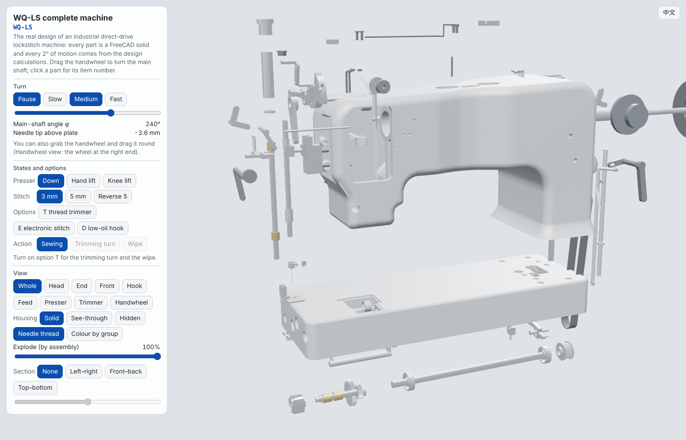
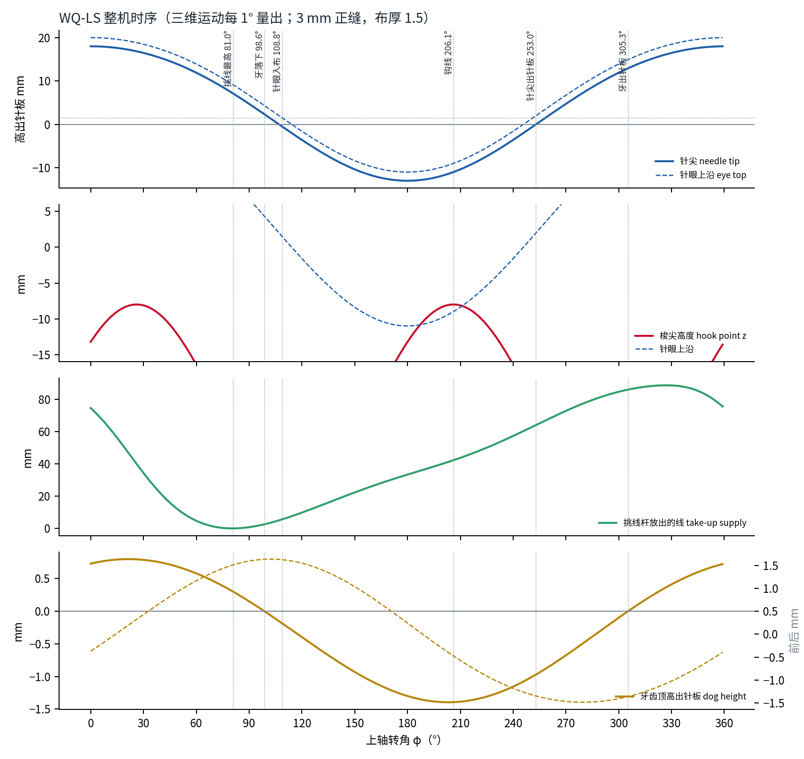
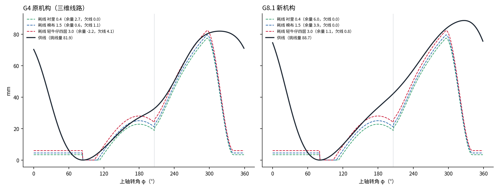
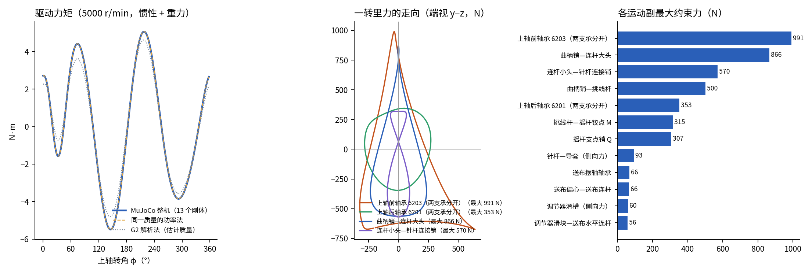

# G8.1 WQ-LS 虚拟样机：三维、装配、运动学、动力学、验证（方案，2026-11-16，施工前先定）

Eddie 11-16 22:06 定的顺序：**先出三维 → 装配和运动学 → 动力学仿真（多做动力学）→ 有限元强度与疲劳寿命（22:09 加）→ 虚拟样机验证 → 最后工程图**。

对象：F 版上轴、外观 B、G8.0 第 1–7 步改完的整机（刺布、挑线、旋梭、送布、抬牙、压脚与操纵、油泵与润滑油路、选配件 T / E）。

## 一、三维整机

| 做什么 | 怎么做 | 交付 |
|---|---|---|
| 20 个整机状态重建 | `cad/mech.py`：针距 3 档 × 压脚 3 态 × 选项（none、TE），加只带 T、只带 E 各 1 组 | 每个零件的 STEP、质量、惯量 |
| 网页三维整机更新 | `g6_web.py` 重打包：新零件（导轨滑块、导套、橡胶塞、SM 螺钉、润滑油路、顶盖观油窗）都进去；爆炸分组加“润滑油路” | 数字工厂 `/wqls/index.html` |
| 物料清单同步 | `g7_bom.py` 重出 8 种变型的 BOM，写进缝纫机厂；前轴承 6203-2RS、中间轴套、滚针组件、SM 螺钉等 | `G7/物料清单.json`、工厂清单 |

验收：每个三维零件都有物料号；网页能转、能爆炸、能剖、点零件有信息；数字工厂测试通过。

## 二、装配

| 检查 | 方法 | 合格标准 |
|---|---|---|
| 全机运动干涉 | 全部零件对、每 2° 一圈；4 种状态（s3 放下、s5 放下、s1 抬起、TE 剪线那一转）。一次跑不完 2 小时，按零件分 4 组分别跑 | 运动件间 ≥ 1.0 mm；油管对运动件 ≥ 3 mm |
| 装配顺序 | 列出总装顺序（机壳 → 上轴组 → 刺布挑线 → 下轴旋梭 → 送布抬牙 → 压脚操纵 → 油路 → 电机 → 盖板），每一步零件从哪个方向装进去，用三维沿装入方向扫一遍，路上不碰已装的件 | 每一步都能装进去 |
| 工具能不能够着 | 每颗螺钉画出螺丝刀 / 内六角扳手的直线通道（长 100，直径按工具），查和整机的距离 | 每颗螺钉都能拧；不能直接够的写出从哪个孔伸进去 |
| 维修动作 | 换针、拆针杆（经机头顶橡胶塞孔）、调针杆高度、换旋梭、加油 | 每个动作都能做，写出步骤 |
| 配合 | 轴承、导套、销、滚针的配合和公差列表，与 G5 精度分析对上 | 表格 |

## 三、运动学

| 内容 | 方法 | 合格标准 |
|---|---|---|
| 整机时序图 | 由三维运动（每 1°）测出：针尖高度、挑线杆线眼、旋梭梭尖角度、送布牙高度和水平位置 | 与 G1 时序图一致 |
| 钩线 | 梭尖到针的最近距离、梭尖经过针时针的回升量、梭尖与针眼的相对高度 | 回升 2.0 ± 0.3；梭尖间隙 0.05–0.10；梭尖在针眼上方 0.5–1.5 |
| 刺布与送布 | 针尖在针板上方时送布牙才能动 | 1–5 mm 针距、正缝和倒缝都满足 |
| 挑线 | 挑线量与一针用线量 | 挑线量 ≥ 用线量（各针距、布厚） |
| 速度、加速度 | 各运动件质心速度、加速度、角加速度曲线 | 给动力学用；最大加速度列表 |

## 四、动力学（重点）

| 编号 | 内容 | 方法 | 交付 / 合格标准 |
|---|---|---|---|
| 4.1 | 整机刚体多体动力学 | 用三维实体的质量和惯量，建整机 MuJoCo 模型（刺布、挑线、旋梭、送布、抬牙、油泵）；5000 r/min 匀速。与 `dyn.py` 解析解逐点对照 | 驱动力矩曲线；每个运动副的约束力（上下轴轴承、曲柄销、连杆小头、滑块对导轨的侧向力、偏心、摆轴）；两种方法相差 ≤ 5% |
| 4.2 | 平衡 | 一阶、二阶不平衡力和力矩，整机对台板的振动力 | 与 G2 比较；平衡率仍在定值 |
| 4.3 | 工况 | 布厚 3 档（薄、中、厚）的刺布阻力；钩线拉线力；线张力；倒缝；剪线那一转（T）；压脚压力 | 每种工况的峰值力矩、轴承力 |
| 4.4 | 启动、停车 | 电机加控制器（`gc_sim.py`）：0 → 5000 r/min 加速、停车针定位、一针一停 | 峰值力矩、峰值电流、转速波动；电机和电控箱余量 |
| 4.5 | 弹性振动 | 上轴弯曲和扭转（实体轴有限元）、针杆—连杆系统、送布系统的固有频率；与激励阶次 1×、2×、4× 比较 | 固有频率避开工作转速下各阶激励 ±15% |
| 4.6 | 机壳振动和噪声 | 4.1 的轴承力作为激励，加在机壳有限元模型上算谐响应（支在台板减振垫上）；按振动速度估算噪声 | 机壳振动速度 ≤ 4.5 mm/s；噪声 ≤ 84 dB(A)（G1 指标） |
| 4.7 | 寿命和强度复核 | 用 4.1、4.3 的载荷谱：上下轴轴承 L10、滚针组件、导套和中间轴套 pv、滑块与导轨接触应力、连杆和曲柄销疲劳 | 全部达到 G2 定的寿命和安全系数 |

## 四′、有限元强度与疲劳寿命（Eddie 11-16 22:09 加）

载荷都取第四步算出来的：每个零件在一转里每 1° 的受力（4.1 匀速、4.3 各工况、4.4 启停的峰值）。工具：数字工厂 CAE（Gmsh 二阶四面体 + CalculiX），与 G2 上轴有限元同一套。

**设计寿命**：一班 2000 h/年 × 10 年，按 5000 r/min 满速算，主轴转 6 × 10⁹ 转。曲柄、连杆、针杆等每转受一次的零件按 10⁹ 次以上的无限寿命设计；旋梭轴组每转两次。

| 编号 | 零件 | 有限元算什么 | 疲劳怎么评 |
|---|---|---|---|
| F1 | 上轴（F 版） | 一转里每 10° 一个载荷步：弯曲、扭转应力，轴肩、键槽、紧定螺钉孔处的应力集中 | FKM 规范（表面、尺寸、缺口系数）；Goodman 修正；安全系数 ≥ 1.5 |
| F2 | 下轴、旋梭轴 | 同上 | 同上 |
| F3 | 曲柄（带平衡块）、曲柄销 | 销孔、紧定螺钉孔、销根部 | 同上；曲柄销还要查滚针滚道接触疲劳 |
| F4 | 针杆连杆、挑线杆、摇杆 | 杆身拉压和弯曲，两头孔边 | 同上 |
| F5 | 针杆 | 刺布阻力下的弯曲和压杆稳定，刻线槽、线钩处缺口 | 同上；稳定安全系数 ≥ 3 |
| F6 | 针杆连接块、滑块、导轨 | 连接块夹紧和销孔；滑块—导轨赫兹接触 | 接触疲劳按 GCr15、45 钢淬火的许用值 |
| F7 | 送布偏心、连杆、送布摆轴、抬牙摆轴、牙架 | 各自载荷 | FKM；安全系数 ≥ 1.5 |
| F8 | 旋梭齿轮 1 : 2 | ISO 6336：齿根弯曲、齿面接触 | 按 6 × 10⁹ 转寿命 |
| F9 | 剪线凸轮与滚子（选配 T） | 凸轮—滚子接触 | 接触疲劳 |
| F10 | 机壳 | 轴承座在最大轴承力下的变形（影响三孔同轴度和齿轮中心距）；轴承座、立柱根部的应力 | 灰铸铁 HT250 疲劳极限；变形 ≤ 精度预算里留的份额 |
| F11 | 螺钉连接 | 曲柄销螺钉、导轨螺钉、曲柄紧定螺钉在振动载荷下会不会松：预紧力、横向滑移 | VDI 2230 简化校核 |

交付：每个零件一张应力云图和一行结论（最大应力、位置、安全系数、寿命）；不够的改结构，改完重算。

## 五、虚拟样机验证

- 一份验证报告 `G8/G8.1_虚拟样机验证报告.md`：把 G1 设计任务书的每一项指标、G2 和 G8.0 定的每一条要求列成表，写“要求 / 仿真结果 / 合格否 / 出处”。
- 不合格的项写原因和改法，改完重算；报告里留改动记录。
- 网页三维加一个曲线面板：转动手轮时同步显示驱动力矩、主要轴承力、机壳振动，转角对齐三维画面。

## 六、工程图（最后）

- 机壳 8 张重出（上件、下件、合件、毛坯）。
- 第 6、7 步的新零件和改过的零件补零件图。
- 总装图和爆炸图。
- 按 `g5_drawings.py` 现有方法，两张一起跑。

## 七、顺序与每步怎么交

每一大步做完：结果写进本文件后面的施工记录，提交、推送，向 Eddie 汇报，再做下一步。动力学 4.1–4.7、有限元 F1–F11 各自单独汇报。偏离本方案的先写回这里再动手。

## 施工记录

### 第一步 三维整机（2026-11-16 晚）

- 20 个整机状态按 F 版、外观 B、第 6、7 步重建：基本型每个状态 93 个零件，带 T、E 的 110 个；变型合计 116 个不同零件。
- 网页三维（数字工厂 `/wqls/index.html`）重新打包：网格 159 份、19.5 万个三角形（2.14 MB），运动 63 段（0.54 MB）。爆炸分组新加“润滑油路”（黄色，往上推开）。页面在浏览器里打开没有报错，转动、爆炸正常。
- 物料清单 `g7_bom.py` 重出：8 种变型 109–111 行，新物料（6203-2RS、6201-2RS、两种滚针组件、橡胶塞、SM 螺钉、油路件）进了缝纫机厂；与工厂清单核对 0 差异；数字工厂相关测试通过。
- 零件表里一处英文名带逗号被 YAML 拆开，已加引号。

### 第二步 装配（完成，2026-11-17）

**装配顺序：机头上轴、刺布挑线这一段 19 步全部走通**（`tools/wqls/g81_assembly.py`，状态 s3 放下、带 T、E；零件表面取 1500 个点，查它沿装入路线每一位置进机壳、进已装零件多深，超过 0.3 mm 算碰）。结果 `assembly.json`，19 步全部 OK。

按顺序：滑块导轨 → 导轨螺钉 → 立柱里的同步带轮、送布偏心 → 上轴中间含油轴套 → 上轴 → 前轴承 6203-2RS → 曲柄组（机外先装好）→ 挑线杆 → 连杆 → 滑块 → 针杆连接块 → 针杆 → 针夹 → 紧针螺钉 → 机针 → 机头顶橡胶塞 → 挑线摇杆和销 → 摇杆支点销 → 分油块。

检查中定下来、或为了装得进去而改过的地方：

| 项 | 怎么装 / 改了什么 | 为什么 |
|---|---|---|
| 上轴 | 从左面板口穿进，经中间轴套、带轮、偏心到后轴承 | 立柱一侧没有直线通道 |
| 机头里的零件 | 中间轴套、前轴承、曲柄组、挑线杆、连杆等一律从前窗口送进去 | 机头没有别的口子够得着 |
| 滑块导轨 | 往左让 10、抬高 11、上端往右斜 5° 送进前窗口；进去后往右 5、扶正、推到竖筋上放下 | 窗口右下角圆角和上导套座之间只有约 25.5 mm，导轨宽 25；斜 5° 后全程最近还剩 0.31 mm。装配说明里写明“沿窗口内侧扶着送” |
| 导轨螺钉 | 必须在针杆组、压脚杆组之前拧 | 之后螺丝刀够不着 |
| 挑线摇杆与支点销 | 先放摇杆，再从前窗口沿 x 压销穿过摇杆 | 摇杆在销座右边，销先进去摇杆就放不进 |
| 分油块（改零件） | 竖边倒 R5.5（`cad/oil.py`），和平台 R6 圆角同心、四周均匀留 0.5 | 原来直角顶到平台圆角，放不下去 |
| 针杆连接块定位螺钉（改零件） | 朝 −y（前窗口） | 内六角扳手只能从前窗口进 |

**工具通道（重建后重查，`g81_tools.py`）**：针杆连接块两颗紧定螺钉朝前后，扳手从前窗口进，离机壳最近 5.7 / 12.2 mm；紧针螺钉 1.6 mm（曲柄转到 50° 时最宽）；分油块 M4 4.8 mm（拆顶盖后）；油毡盒螺钉 0.98 mm（机头顶外面，偏紧但够得着）。导轨两颗螺钉在针杆装上以后被针杆挡住（−6.4 mm），所以只能在装针杆之前拧；以后要拆导轨，得先抽出针杆——写进维修动作。

**维修动作**（按装配检查和工具通道的结果写；“已查”指三维里查过零件路线或工具通道）

| 动作 | 步骤 | 依据 |
|---|---|---|
| 换针 | 手轮转到针杆在上面（曲柄约 50°，紧针螺钉前面最空，工具离最近零件 1.6 mm）→ 松紧针螺钉 → 往下抽出旧针 → 新针长槽朝左插到底 → 拧紧 | 已查（工具通道） |
| 调针杆高度 | 拆面板（前窗口）→ 手轮转到针杆最低 → 内六角扳手从前窗口伸进去，松针杆连接块两颗紧定螺钉（离机壳 5.7 / 12.2 mm）→ 上下推针杆，让刻线 A 对齐下导套下端 → 拧紧 | 已查（螺钉朝前，工具通道） |
| 拆针杆 | 拆面板 → 松针夹、取下机针和针夹 → 松针杆连接块两颗紧定螺钉 → 拔掉机头顶橡胶塞 → 针杆从顶上 Ø12 孔往上抽出；装回按反序，再调针杆高度 | 已查（装配第 12、16 步反过来） |
| 换导轨 | 先拆针杆（上一条）→ 螺丝刀从面板口拧下导轨两颗螺钉 → 导轨往上抬、往左 5、上端往右斜 5° 从前窗口取出（0.31 mm，沿窗口内侧扶着） | 已查（装配第 1、2 步反过来；不先拆针杆，螺丝刀被针杆挡住） |
| 加油 / 换油毡 | 机头顶油毡盒螺钉在外面（工具离 0.98 mm，偏紧但能拧）；分油块 M4 要先拆顶盖（4.8 mm） | 已查（工具通道） |
| 换旋梭 | 机头往后翻倒 → 取出梭芯套 → 转手轮，让旋梭轴套上的紧定螺钉朝下 → 扳手或螺丝刀从机座底下往上伸，离机壳最近 8.2 mm（内六角）/ 7.0 mm（一字）→ 松开，旋梭沿轴往左取下；装新旋梭后按梭尖间隙 0.08、钩线角重新对好再拧紧 | 已查（工具通道，`g81_tools.py` 加了旋梭紧定螺钉） |

**配合表**：`G8.1_配合表.md`（`tools/wqls/g81_fits.py` 按 GB/T 1800 算出）。共 32 处配合；前面只定了孔、没写轴或套的 23 处，这次补定，规则是：
- 转动的滚动轴承内圈 k5、外圈对 H7；
- 压入的套和销：套 r6、销孔 R7；
- 有相对转动或摆动的销和孔：F7/h6；慢速转的操纵轴 H7/g6；
- 针杆、压脚杆在导套里 F7/h6；
- 曲柄销兼作滚针内滚道：h5，淬硬 HRC ≥ 58；滚针座孔 G6。

和 G5 精度分析对上了：几个同轴度、位置度要求的孔都是 H7，精度预算占用 30%–73%，都合格。

**全机运动干涉**（`mech_check.py` 分 20 片跑完，汇总 `G8.1_运动干涉.json`，285 对零件）：

| 状态 | 片数 | 步距 | < 1.0 mm 的 |
|---|---|---|---|
| s3 正缝 3 mm、压脚放下，带 T、E | 8 | 每 2° | 无 |
| s5 正缝 5 mm、压脚放下 | 4 | 每 4° | 无 |
| 倒缝 5 mm、膝抬 13 mm | 4 | 每 4° | 针杆、针夹、针夹螺钉碰压脚（φ 136°–144°），按联锁排除，见下 |
| 剪线那一转 | 4 | 每 4° | 无（动刀对旋梭 0.6、对送布牙 0.66，设计要求 ≥ 0.5） |

- 和方案的差别：只有 s3 每 2°，其余三种状态每 4°（每 2° 跑不完）；两对整齿齿轮对机壳（下轴齿轮、旋梭轴齿轮）每 12° 查一次——它们绕自己的轴转、机壳不动，一帧要 30 s。
- 膝抬三对：G4.7（`G4/压脚与操纵件.md`）已定——控制器只在针杆停在上面时抬压脚；针停在下面时膝抬，压脚碰到针夹就抬不上去（约 7 mm），不损坏。这次批量检查没加排除，所以又报出来；针夹螺钉是新件，同一条规则。
- 正好 1.0 mm 的 14 对（针夹、调节器滑块、针杆、调节器、动刀、摇杆、压脚杆套环对机壳；针杆导套对曲柄销、连杆、挑线杆；电机端盖对绕组等）是设计时就按 1.0 留的，满足要求但没有余量。**对机壳的 7 处在铸造毛面上，铸造误差会吃掉这 1 mm——第六步工程图里这几处标加工面，或把避让放大到 2 mm。**
- 油路：油管对所有运动件 ≥ 3.5 mm，合格；油毡杯离曲柄销、挑线杆连杆 1.5 mm（软毡，满足 1 mm）。

**第二步结论：装配 19 步走通，工具通道除导轨螺钉外都够得着（导轨螺钉规定在装针杆前拧），维修 6 个动作都查过，配合 32 处全部定好，全机运动无干涉。**

### 第三步 运动学（完成，2026-11-17）

`tools/wqls/g81_kin.py`：整机三维的运动每 1° 一帧（`g4_mech.frames(step=1)`，送布组每 1° 重算），量针尖、针眼、梭尖、挑线线路、送布牙齿顶和每个运动件的质心。结果 `G8.1_运动学.json`，图 `G8.1_时序图.png`、`G8.1_惯性力.png`；每个零件每 1° 的质心速度、加速度、角速度、角加速度写在零件目录的 `kin_1deg.json`，给第四步。

**时序**（3 mm 正缝、布厚 1.5）：和设计值对上，差 ≤ 0.2°。

| 事件 | 三维量出 | 设计值 | 出处 | G1 理想值 |
|---|---|---|---|---|
| 钩线（梭尖经过针） | 206.1° | 206.1° | G1 | 206.1° |
| 针眼入布 | 108.8° | 109° | G1 | 109° |
| 挑线杆最高 | 84° | 84° | G4 挑线杆共用曲柄销后 | 55° |
| 送布牙出针板 | 305.3° | 305.3° | G4.6 连杆送布 | 319.8° |
| 送布牙落下 | 98.6° | 98.6° | G4.6 | 108.2° |

挑线杆、送布牙和 G1 理想值差 14–29°，是 G4 换机构时已经定下的（挑线杆改成和连杆共用曲柄销；送布用连杆机构，轨迹不是正椭圆），判据都在 G4 校核过，这里只记录。

**钩线**：梭尖经过针时针回升 2.005 mm（要求 2.0 ± 0.3），梭尖高出针眼上沿 0.99 mm（0.5–1.5），梭尖间隙 0.08（0.05–0.10）。合格。

**刺布与送布**：正缝、倒缝 1–5 mm 共 10 档，针在布里时送布牙推布的距离——衬里 0.4、棉布 1.5：0；轻牛仔四层 3.0：≤ 0.040 mm（倒缝 5 mm 最大）。要求 ≤ 0.05，合格。布厚按任务书“轻薄到中厚，轻牛仔两到四层”取到 3.0（每层约 0.75）；sewcore 的 denim 4.0 只作参考：倒缝 3–5 mm 是 0.06–0.09，超出，说明书写明 4 mm 以上厚料倒缝针距不超过 2 mm。

**速度、加速度**：5000 r/min。针杆质心加速度和 sewcore 精确式对照，最大差 0.004%（数值求导的方法可信）。惯性力最大的几件：

| 零件 | 质量 g | 最大速度 m/s | 最大加速度 m/s² | 最大惯性力 N |
|---|---|---|---|---|
| 针杆 | 70.9 | 8.43 | 5447（下止点） | 386 |
| 曲柄（带平衡块） | 120.7 | 6.06 | 3173 | 383 |
| 针杆连杆 | 58.3 | 8.19 | 4666 | 272 |
| 挑线杆 | 32.0 | 9.91 | 7586（47°） | 243 |
| 针杆连接块 | 18.0 | 8.43 | 5447 | 98 |
| 摇杆 | 10.9 | 5.42 | 4733 | 51 |
| 送布连杆 | 48.6 | 1.58 | 831 | 40 |

压脚组没有列：三维里没有布，压脚放下时被送布牙顶起，牙出针板那一刻速度跳变，加速度是假尖峰；第四步按弹簧压在布上算。

**挑线：G4 原机构不合格（下面 1–3），已按 Eddie 定的做法重新综合，新机构合格（见本节末“结果”）。**

1. 三维线路比 G4 少 10 mm：原来面线路线里过线点 A 在 x 40、B 在 x 0，挑线杆线眼在 x 21.5。G4 综合挑线机构时只看端视，没算 x 方向这两段斜边。三维里挑线量 73.4 mm，比 G4 的 83.6 少 10 mm，余量从 +3.0 变成 −8.8——钩线绕梭时线被提前拉紧，会断线。这两个过线点原来只是线路上的点，没有建零件。
2. 试着把 A、B 都放到挑线杆平面上（x 21.5）：挑线量回到 83.6，但面线路径检查（`thread_check.py`）查出挑线簧 → A 那段线在 φ 0 穿过挑线杆。A 让到杆外 3 mm（x 28.5）：挑线量 81.9，棉布余量 0.6、入布后欠线 1.05，又不合格。现在 `g4_mech.py` 里是这个位置（A x 28.5、B x 21.5），只是临时的。
3. 轻牛仔四层（布厚 3.0）就算只看端视也不够：余量 0.2（要求 ≥ 1），入布后欠线 3.9 mm（≤ 1）。G4 综合时只按棉布 1.5 算，任务书的面料范围没算全；调过线点 A（sewcore 的 u）是一项变好另一项变坏，调不出来。

建议：用三维线路（过线点按实际能放的位置，让开挑线杆）重新综合挑线四连杆，衬里 0.4、棉布 1.5、轻牛仔 3.0 同时满足；挑线杆、摇杆改尺寸，过线点 A、B 建成零件；机头这一段的装配、干涉、面线路径重查。

**挑线四连杆重新综合（Eddie 11-17 14:18 定“按建议”）——做法**

- 新脚本 `tools/wqls/g81_takeup.py`，沿用 G4 `g4_takeup.py` 的搜索（差分进化 + Nelder–Mead，种子固定）和全部实体约束（线眼伸出、竖槽、摇杆不碰平衡块/连杆、杆件在机头里、线眼加速度），只换两处：
  1. 供线按三维线路算：过线点 A 在挑线杆右侧 x 28.5（让开杆 3 mm），线眼和过线点 B 在挑线杆平面 x 21.5；
  2. 衬里 0.4、棉布 1.5、轻牛仔四层 3.0 三种布厚同时满足（余量 1–6 mm、入布后欠线 ≤ 1、入布前多余 ≤ 挑线簧行程 10），针距 3 mm（针距不影响这几项）。
- 结果写回 `G4/挑线机构.json`（旧的记在 `G8.1_挑线机构.json` 里对照），`g4_mech.py` 读新的过线点位置。
- 重建 20 个整机状态，重查：装配第 14–17 步（挑线杆、摇杆、销）、机头这一段的运动干涉（s3、r5 膝抬两种状态）、面线路径、`g81_kin.py` 全部。
- 施工中加了两条约束（偏差，已写在 `g81_takeup.py` 里）：
  1. 传动角上限 140°：第一次综合传动角最大 172°，接近死点；G1 的判据本来就是 40°–140°，G4 只限了下限。
  2. 摇杆—挑线杆铰点走到前壁附近时不高过 v 25（z 225）：第二次综合的铰点升到 v 27.4，挑线杆、摇杆碰前盖板窗口上沿（三维干涉 0 和 0.66 mm）。

**结果（新挑线机构，合格）**

| 项目 | G4 原机构（三维线路） | G8.1 新机构 | 要求 |
|---|---|---|---|
| 曲柄半径 r / 挑线杆 a / 连杆 b / 摇杆 c（mm） | 15.5 / 33.37 / 23.41 / 72.72 | 15.5 / 34.21 / 26.06 / 66.5 | — |
| 摇杆支点 (v, u) | (33.0, 20.71) | (32.98, 18.35) | 在机头顶销座里 |
| 过线点 A / B（端视 u, v） | (51.17, −6.46) / (50.15, −52.26) | (51.17, −16.81) / (52.64, −54.96) | — |
| 挑线量 | 81.9 | 88.7 | — |
| 衬里 0.4：余量 / 欠线 | 2.65 / 0 | 5.99 / 0 | 1–6 / ≤ 1 |
| 棉布 1.5：余量 / 欠线 | 0.60 / 1.05 ✗ | 3.94 / 0 | 1–6 / ≤ 1 |
| 轻牛仔四层 3.0：余量 / 欠线 | −2.22 / 4.05 ✗ | 1.12 / 0.78 | 1–6 / ≤ 1 |
| 入布前多余（最大） | 5.22 | 6.96 | ≤ 挑线簧行程 10 |
| 传动角 | 44.7°–146.6° ✗ | 40.6°–123.5° | 40°–140° |

重查（新机构重建整机后）：
- 运动学 `g81_kin.py`：全部合格（时序、钩线、送布、挑线三种布厚）。
- 运动干涉（挑线这一段，s3 放下、r5 膝抬，每 2°）：没有小于 1 mm 的；最近是摇杆对机壳 1.0 mm。
- 面线路径 `thread_check.py`：面线不碰零件；最近是旋梭 0.49 mm，在 φ 180 梭尖钩住线环那一刻，本来就该贴着线。
- 装配顺序：19 步全部 OK（挑线杆、摇杆、支点销照原来的方向装得进去）。

注意：
- 轻牛仔四层是紧的（余量 1.12，入布后欠线 0.78，离限值都只差 0.2 左右）。第五步虚拟样机缝纫时重点看这一档。
- 挑线杆、摇杆尺寸变了：第六步工程图、物料表要跟着改（网页三维已在第 172b 轮按新机构重出）；过线点 A（x 28.5）、B（x 21.5）第六步建成零件。
- 第四步动力学（`dyn.py`、`g4_ctrl`）直接读新的 `G4/挑线机构.json`。
- 控制器 CTRL-LS 固件仿真用的一转负载表也由 `dyn.py` 算（第 159 轮），挑线机构换了以后重出（`gen_load.py`、`ref_159c.py`，Renode 四个场景重跑全部通过；剪线转速平均 295.09 → 295.07 r/min）。

### 第四步 动力学（进行中，2026-11-18）

**4.1 整机刚体多体动力学（完成）**：`tools/wqls/g81_dyn.py`。

- 模型：整机运动件按刚性连接合成 14 个刚体（上轴组 1667 g、针杆组 104 g、针杆连杆 64 g、挑线杆 38 g、挑线摇杆、下轴组、旋梭轴组，送布、抬牙链 7 件），质量、质心、转动惯量取 FreeCAD 实体（几个多实体零件的惯量用 `cad/inertia_fix.py` 补算）。运动副位置取整机运动；上轴、下轴、旋梭轴、各摆轴绕固定轴转，连杆类铰接在上一级，针杆、调节器滑块直线滑动，闭环 6 处用 connect 约束，同步带 1 : 1、齿轮 1 : 2 用关节等式。上轴 5000 r/min 匀速驱动，MuJoCo 步长 1 µs 积分两转，取第二转每 1°。
- **驱动力矩**：最大 5.06、最小 -5.49 N·m，均方根 3.10 N·m（惯性 + 重力，不含缝纫阻力）。与同一质量模型的功率法（T·ω = Σ m a·v + Σ I θ̇ θ̈ + Σ m g ż，不经过 MuJoCo）逐点比，最大差 0.0077 N·m（0.14 %），**合格（≤ 5 %）**。
- 与 G2 解析法（`dyn.py`）比大 18 %（G2 峰值 4.62 / -4.80）：G2 用的是估计质量（针杆组 90 g、挑线杆 25 g、送布折算 50 g），G8 整机实体更重（针杆组 104 g、挑线杆 38 g，送布、抬牙链 7 件合计约 400 g）。**这影响电机和控制器**：G2/GC 按峰值约 4.8 N·m 定的转子惯量和 3.0 N·m 力矩上限，4.4 启停、转速波动要用这次的力矩重算；控制器固件仿真的负载表也要换成这次的。
- **各运动副最大约束力**（N）：上轴前轴承 991、后轴承 353（两支承分开；中间含油轴套的分担 4.7 用轴的梁模型算）；曲柄销—连杆大头 866；连杆小头—针杆连接销 570；曲柄销—挑线杆 500；挑线杆—摇杆铰点 M 315；摇杆支点 Q 307；针杆对导套侧向 93；送布、抬牙链各副 6–66；下轴 28、旋梭轴 1.3（匀速转、近乎平衡）。同步带传的力矩最大 0.011 N·m。
- 没进模型的：压脚组（没有布时被送布牙顶起，4.3 按弹簧压在布上算）、油泵柱塞、同步带质量。

下一步 4.2 平衡、4.3 工况（缝纫阻力、压脚弹簧、剪线那一转）、4.4 启停（电机 + 控制器，用这次的负载）、4.5–4.7。
