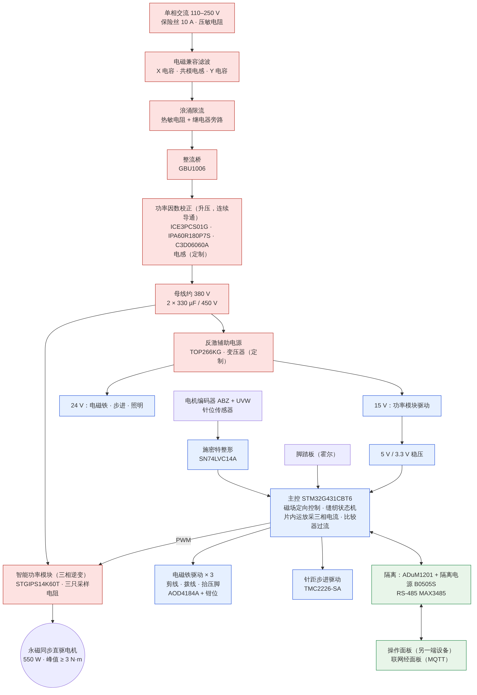

# 平缝机控制器 CTRL-LS · 系统方案与选型（第 159 轮 159a）

示例设计，未经硬件验证，不能直接投产；器件是示例选型。架构照第 138 轮 GC（Eddie 11-10 定）：单相 110–250 V 宽电压输入 → 有源功率因数校正 → 母线 → 智能功率模块逆变 → 永磁同步直驱电机。

框图源文件 `控制器框图.mmd`（红：强电；蓝：以母线负端为地的弱电；绿：与人能碰到的接口之间隔离）。

## 一、一块板，主控以母线负端为地

功率部分和主控做在同一块板上（细则第二节第 1 条）。主控不隔离、直接以母线负端为地，这样三相电流用下桥采样电阻、MCU 片内运放直接采，功率模块的输入也不用隔离。
人能碰到的只有操作面板和它后面的联网：这一路经数字隔离 ADuM1201 和隔离电源 B0505S。脚踏板、电机编码器、针位传感器、电磁铁、步进电机都在机头和电控箱里，按“不可触及”处理（159d 的安全一节写清楚它们的绝缘要求）。

## 二、由规格推出来的额定值（第一遍，159b 的计算书逐项复核）

| 项 | 推法 | 结果 |
|---|---|---|
| 母线电压 | 输入最高 250 V，留 10% 电网波动：250 × 1.1 × √2 = 389 V；升压级的输出必须高于输入峰值才能调节 | **390 V**（第 138 轮写“约 380 V”，按这条改为 390 V） |
| 母线电容耐压 | 本设计电容降额 1.25（沿用关节驱动板的设计规则）：390 × 1.25 = 488 V | **500 V**（450 V 不够） |
| 电机反电势 | 选电机时的要求：5000 r/min 时线反电势峰值 ≤ 300 V，给母线留余量 | 线反电势常数 ≤ 300 ÷ 523.6 rad/s = 0.573 V·s/rad（峰值） |
| 电机力矩常数 | 磁场定向控制下 Kt = 1.5 × 相反电势常数（峰值）= 1.5 × 0.573 ÷ √3 | 0.496 N·m 每安（相电流峰值） |
| 相电流 | 峰值力矩 3 N·m ÷ 0.496；第 138 轮仿真的力矩均方根 0.58 N·m ÷ 0.496 | 峰值 6.05 A；均方根力矩对应 1.17 A（峰值） |
| 母线功率 | 电机额定 550 W ÷ 电机效率 0.90 ÷ 逆变效率 0.97 + 辅助电源 ≤ 40 W | 约 670 W |
| 输入电流 | 670 W ÷ 校正效率 0.95 ÷（90 V × 功率因数 0.99） | 约 7.9 A（有效值），保险丝 10 A 慢断 |

效率、功率因数是第一遍的取值（标“假设”），159b 用规格书参数算出损耗后替换；电机是按上面的要求定制的永磁同步直驱电机（第 138 轮 G2 已定 550 W、峰值 ≥ 3 N·m、转子加手轮 4 × 10⁻⁴ kg·m²）。

## 三、器件表

25 种外购件和 2 种定制磁性元件。外购件 2026-11-11 在立创 LCSC 逐个打开核实型号存在、有货；机读清单 `factory/designs/ctrl-ls/parts.yaml`（159d 生成原理图和物料清单用）。

| 用途 | 型号 | 厂家 | 立创编号 |
|---|---|---|---|
| 输入保险丝（5×20 mm，10 A 慢断） | 0215010.MXP | Littelfuse | [C142733](https://www.lcsc.com/product-detail/C142733.html) |
| 压敏电阻（275 V 交流） | B72214S0271K101 | TDK | [C7502584](https://www.lcsc.com/product-detail/C7502584.html) |
| X2 电容 0.47 µF | BFC233920474 | Vishay | [C511073](https://www.lcsc.com/product-detail/C511073.html) |
| Y 电容 2.2 nF | DE1E3RA222MA4BP01F | Murata | [C907949](https://www.lcsc.com/product-detail/C907949.html) |
| 共模电感 15 mH 10 A | FC-HLF2018-15mH-10A-LF | FANGCHENG | [C5142780](https://www.lcsc.com/product-detail/C5142780.html) |
| 浪涌限流热敏电阻 | B57364S0259M000 | TDK | [C17362791](https://www.lcsc.com/product-detail/C17362791.html) |
| 旁路继电器（12 V 线圈） | G5LE-1-E DC12 | Omron | [C152711](https://www.lcsc.com/product-detail/C152711.html) |
| 整流桥 10 A 600 V | GBU1006 | LGE | [C5183365](https://www.lcsc.com/product-detail/C5183365.html) |
| 连续导通功率因数校正控制器 | ICE3PCS01G | Infineon | [C192050](https://www.lcsc.com/product-detail/C192050.html) |
| 升压开关管 600 V 180 mΩ | IPA60R180P7S | Infineon | [C2916134](https://www.lcsc.com/product-detail/C2916134.html) |
| 升压二极管（碳化硅 6 A 600 V） | C3D06060A | Wolfspeed (Cree) | [C5693025](https://www.lcsc.com/product-detail/C5693025.html) |
| 升压电感 | 定制（规格见 159b 计算书） | — | — |
| 母线电容 330 µF 500 V | 500MXH330MEFCSN30X50 | Rubycon | [C472902](https://www.lcsc.com/product-detail/C472902.html) |
| 智能功率模块（三相，14 A 600 V，带热敏电阻） | STGIPS14K60T | STMicroelectronics | [C5268145](https://www.lcsc.com/product-detail/C5268145.html) |
| 三相下桥采样电阻 25 mΩ 2512 | WSLT2512R0250FEA | Vishay | [C4210426](https://www.lcsc.com/product-detail/C4210426.html) |
| 反激控制器（集成开关管） | TOP266KG | Power Integrations | [C568204](https://www.lcsc.com/product-detail/C568204.html) |
| 反激变压器 | 定制（规格见 159b 计算书） | — | — |
| 反馈光耦 | PC817X2NSZ9F | Sharp | [C390734](https://www.lcsc.com/product-detail/C390734.html) |
| 反馈基准 | TL431AIDBZR | Texas Instruments | [C23892](https://www.lcsc.com/product-detail/C23892.html) |
| 主控 | STM32G431CBT6 | STMicroelectronics | [C529355](https://www.lcsc.com/product-detail/C529355.html) |
| 编码器与针位信号施密特整形 | SN74LVC14APWR | Texas Instruments | [C7663](https://www.lcsc.com/product-detail/C7663.html) |
| 电磁铁驱动管 40 V | AOD4184A | Alpha & Omega | [C99124](https://www.lcsc.com/product-detail/C99124.html) |
| 电磁铁关断钳位 | SMBJ33A | Littelfuse | [C224019](https://www.lcsc.com/product-detail/C224019.html) |
| 针距步进驱动 | TMC2226-SA | ADI / Trinamic | [C6718351](https://www.lcsc.com/product-detail/C6718351.html) |
| 面板口数字隔离 | ADUM1201ARZ-RL7 | Analog Devices | [C9669](https://www.lcsc.com/product-detail/C9669.html) |
| 面板口隔离电源 5 V→5 V 1 W | B0505S-1WR2 | YLPTEC | [C2992393](https://www.lcsc.com/product-detail/C2992393.html) |
| 面板口 RS-485 | MAX3485ESA+T | Analog Devices (Maxim) | [C18148](https://www.lcsc.com/product-detail/C18148.html) |

阻容、晶振、连接器等通用件在 159d 生成原理图时按封装和数值选，和关节驱动板一样走“到外部库查”的链接。

## 四、几处选择和原因

- **功率模块选 ST 的 STGIPS14K60T**：KiCad 官方库里有它的符号和封装（SDIP-25L），整个流程能自动生成；14 A 对峰值 6.05 A 余量足，内带三相驱动、自举二极管和热敏电阻。
- **校正控制器选英飞凌 ICE3PCS01G（连续导通模式）**：670 W 用临界导通模式电流峰值太大；KiCad 库里有符号。
- **辅助电源选 TOP266KG**：电磁铁吸合时 24 V 要几十瓦的脉冲，小功率离线芯片（VIPer、TNY）带不动；TOP26x 在 KiCad 库里有。
- **编码器接口不用 WQ-ENCIF**：第 138 轮 GC 提过用它，但它没流片、买不到，和“器件都是查得到的真型号”冲突；电机编码器 ABZ 和霍尔 UVW 经 SN74LVC14A 整形后进 MCU 定时器的编码器模式。
- **电流采样用 MCU 片内运放**：STM32G431 有三路运放和比较器，下桥采样直接用，比关节驱动板少三颗 INA240。
- **定制磁性元件**：升压电感和反激变压器没有对口的现成型号，159b 由计算给出磁芯、匝数、线径，按规格找绕制厂，这两项在物料清单里标“定制”。

## 五、和细则的偏差

- 细则 159a 写了“`eda/parts/` 补录规格书参数”“设计描述骨架 design.yaml”：参数要逐项对规格书的页码录，和用它的计算一起做更不容易错；design.yaml 的功能块还没有实现，先写骨架会让现有的检查报错。两项都挪到 159b，和新功能块一起提交。
