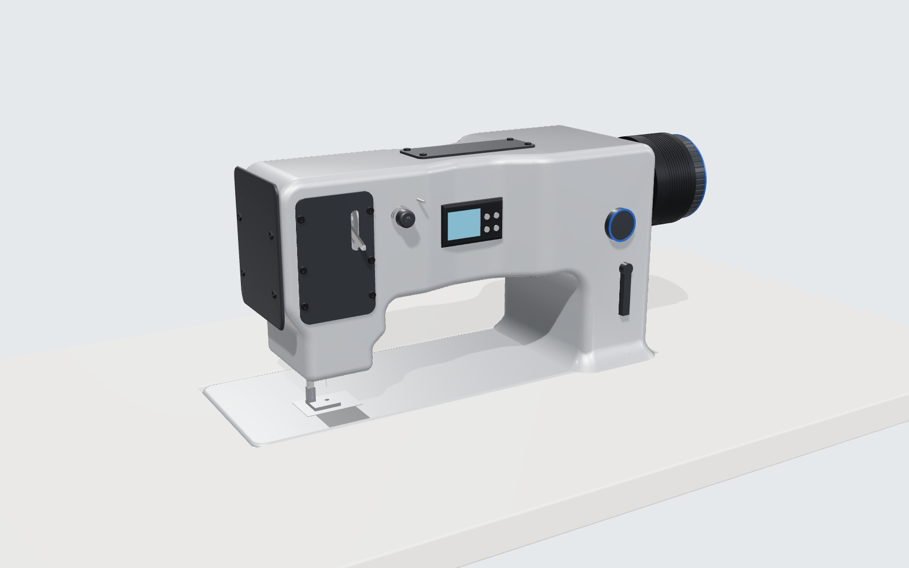
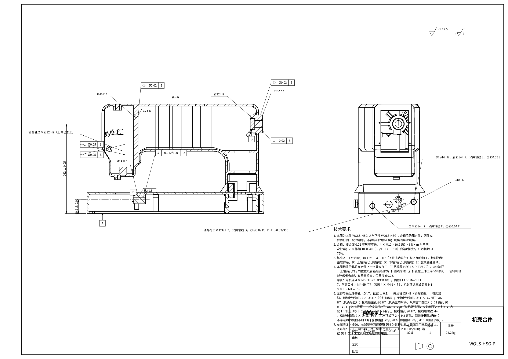

# 三维与图纸

> **[打开 WQ-LS 设计说明书 ↗](/wqls/spec/)**
>
> 完整版：首页是整机虚拟样机和 3 分钟介绍视频；G1 任务书到 G8 虚拟样机的全部设计文档、计算书、工程图和物料清单，左边总目录、可搜索全文（第 172 轮，`tools/wqls/spec_web.py`）。
>
> 只看三维整机（设计说明书里也能打开）：[WQ-LS 整机](/wqls/index.html?opt=TED)——98 个零件、每 2° 的运动、8 种变型、剪线和拨线、爆炸与剖开；点任一零件看物料号、材料、质量、图纸和计算书（第 138 轮 G6.1，`tools/wqls/g6_web.py`）。

机壳分上件 HSG-LS-U、下件 HSG-LS-L 两件铸造、合箱后精加工（合件 HSG-LS-P）；零件图、毛坯图、夹具总图、工艺卡在 `docs/设计/WQ-LS/G5/工程图/`。
