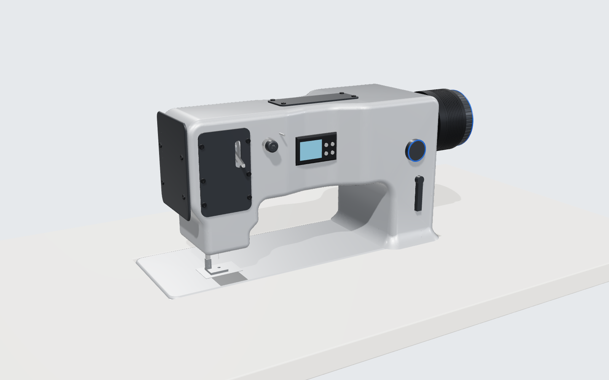
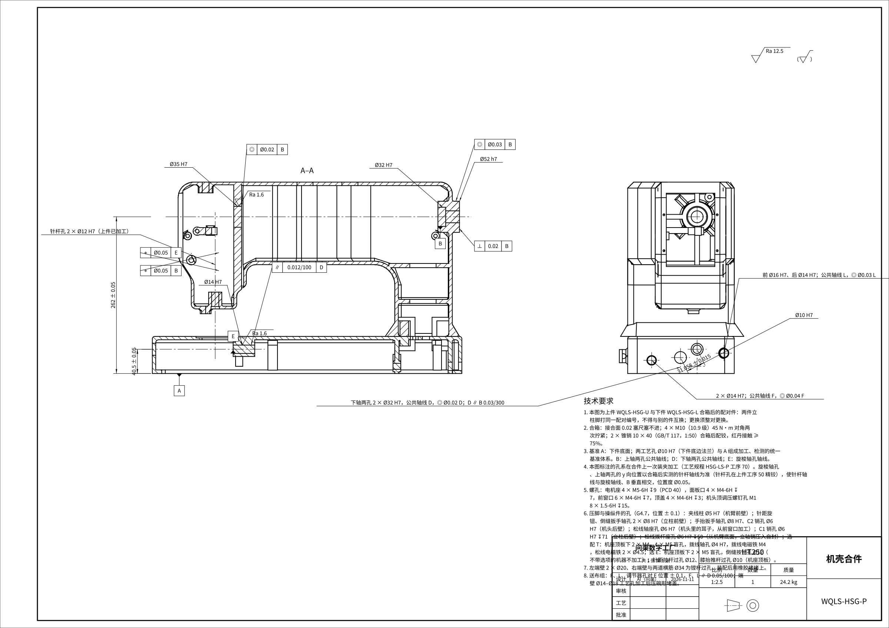

# 三维与图纸

机壳分上件 HSG-LS-U、下件 HSG-LS-L 两件铸造、合箱后精加工（合件 HSG-LS-P）；零件图、毛坯图、夹具总图、工艺卡在 `docs/设计/WQ-LS/G5/工程图/`。

**网页三维整机**：[打开 WQ-LS 整机](/wqls/index.html?opt=TED)——98 个零件、每 2° 的运动、8 种变型、剪线和拨线、爆炸与剖开；点任一零件看物料号、材料、质量、图纸和计算书（第 138 轮 G6.1，`tools/wqls/g6_web.py`）。
